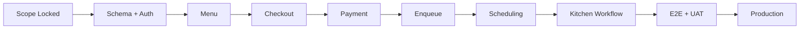

# Development Plan

## Sistem Pemesanan dan Antrean Berbasis Web Menggunakan Metode Priority Scheduling pada Atrium Coffee

Dokumen ini menjadi rencana pelaksanaan pengembangan berdasarkan `PRD.md`, `BUSINESS_RULES.md`, `desain_database.md`, `SYSTEM_DESIGN.md`, dan `DESIGN.md`. Fokus utama adalah menghasilkan MVP Laravel yang dapat diuji, aman terhadap konflik antrean, dan layak digunakan pada operasional satu coffee shop.

## Daftar Isi

- [1. Ringkasan rencana](#1-ringkasan-rencana)
- [2. Tujuan dan prinsip eksekusi](#2-tujuan-dan-prinsip-eksekusi)
- [3. Scope dan prioritas](#3-scope-dan-prioritas)
- [4. Asumsi perencanaan](#4-asumsi-perencanaan)
- [5. Strategi delivery](#5-strategi-delivery)
- [6. Work breakdown structure](#6-work-breakdown-structure)
- [7. Rencana fase pengembangan](#7-rencana-fase-pengembangan)
- [8. Milestone dan dependency](#8-milestone-dan-dependency)
- [9. Rencana database dan migration](#9-rencana-database-dan-migration)
- [10. Rencana frontend](#10-rencana-frontend)
- [11. Rencana testing](#11-rencana-testing)
- [12. Keamanan dan quality gates](#12-keamanan-dan-quality-gates)
- [13. Environment, CI/CD, dan deployment](#13-environment-cicd-dan-deployment)
- [14. Data seed dan UAT](#14-data-seed-dan-uat)
- [15. Monitoring dan operasional](#15-monitoring-dan-operasional)
- [16. Risiko dan mitigasi](#16-risiko-dan-mitigasi)
- [17. Definition of Ready dan Definition of Done](#17-definition-of-ready-dan-definition-of-done)
- [18. Estimasi awal](#18-estimasi-awal)
- [19. Traceability](#19-traceability)
- [20. Post-MVP backlog](#20-post-mvp-backlog)
- [21. Keputusan yang perlu dikonfirmasi](#21-keputusan-yang-perlu-dikonfirmasi)
- [22. Checklist release](#22-checklist-release)

## 1. Ringkasan rencana

Pengembangan dibagi menjadi sembilan fase berurutan dengan validasi pada akhir setiap fase:

```text
Discovery & Foundation
        ↓
Database, Auth & RBAC
        ↓
Menu & Customer Ordering
        ↓
Payment & Queue Creation
        ↓
Priority Scheduling & Kitchen
        ↓
Cashier, Admin & Owner
        ↓
Reporting, Notification & Audit
        ↓
Hardening, UAT & Migration
        ↓
Production Release & Stabilization
```

Prinsip delivery adalah membuat **vertical slice** yang dapat dijalankan sedini mungkin. Alur pertama yang harus berfungsi end-to-end adalah:

```text
Menu → Checkout → Pembayaran valid → Queue
→ Claim dapur → Ready → Completed → Tracking pelanggan
```

## 2. Tujuan dan prinsip eksekusi

### 2.1 Tujuan

- Mengimplementasikan kebutuhan MVP tanpa menambah kompleksitas yang tidak diperlukan.
- Memastikan Priority Scheduling + FCFS + Aging benar secara algoritmik dan operasional.
- Menjamin satu queue tidak dapat diklaim dua petugas secara bersamaan.
- Menyediakan UI responsif dan konsisten dengan `DESIGN.md`.
- Menjaga status order, payment, dan queue tetap sinkron.
- Menghasilkan test suite, dokumentasi, backup, dan prosedur deployment.

### 2.2 Prinsip kerja

1. Business rule diimplementasikan pada domain service, bukan controller atau JavaScript.
2. Harga, total, status, priority, dan urutan queue ditentukan server.
3. Perubahan kritis menggunakan database transaction dan audit trail.
4. Fitur diselesaikan bersama test, authorization, states UI, dan logging-nya.
5. Migration bersifat forward-safe dan tidak menghapus data produksi secara langsung.
6. Gunakan Laravel convention sebelum membuat abstraction baru.
7. Polling digunakan untuk realtime MVP; WebSocket ditunda sampai ada kebutuhan terukur.
8. Satu fase dianggap selesai hanya setelah acceptance gate lulus.

## 3. Scope dan prioritas

### 3.1 Must Have — MVP

- Project foundation, environment, coding standard, dan automated test.
- Authentication pengguna internal dan RBAC.
- Manajemen kategori, menu, harga, foto, serta availability.
- Customer menu, cart, checkout, dan order item snapshot.
- Order kasir untuk pelanggan walk-in.
- Pembayaran manual/tunai dan verifikasi kasir.
- Nomor order dan queue yang unik.
- Queue lifecycle dan tracking pelanggan.
- Non-preemptive Priority Scheduling + FCFS + Aging.
- Atomic claim untuk dashboard dapur.
- Status history, priority change log, dan audit log kritis.
- Dashboard kasir, dapur, admin, dan pemilik versi inti.
- Laporan dasar penjualan dan antrean.
- Responsive UI, accessibility dasar, error/loading/empty states.
- Backup, health check, UAT, dan deployment guide.

### 3.2 Should Have

- QR per meja.
- Payment gateway/QRIS jika provider telah dipilih.
- Web notification/outbox.
- Export laporan Excel/PDF.
- Customer account dan histori pesanan.
- Filter serta chart laporan utama.

### 3.3 Could Have

- Livewire untuk tabel/filter tertentu.
- WebSocket/Laravel Echo.
- Advanced chart dan scheduled report.
- Partial refund.
- PWA shell terbatas.

### 3.4 Tidak dikerjakan pada MVP

- Multi-cabang dan microservices.
- Inventory bahan baku tingkat lanjut.
- Delivery/marketplace.
- Payroll, HR, dan full accounting.
- Scheduling per item atau multi-station sebelum kebutuhan dikonfirmasi.
- Loyalty program.

## 4. Asumsi perencanaan

- Stack: PHP/Laravel, Blade, Tailwind CSS, Alpine.js, MySQL 8.
- Satu order mempunyai satu queue produksi.
- Satu workflow dapur utama.
- Pembayaran harus valid sebelum enqueue.
- Priority MVP berada pada rentang 1–3 dengan default 3.
- Aging default setiap 10 menit dan minimum priority 1.
- Pelanggan dapat melakukan order tanpa akun.
- Pembayaran tunai/manual tersedia walaupun gateway belum ditentukan.
- Realtime awal menggunakan polling 3–5 detik.
- Tim minimum ideal: satu backend/full-stack, satu frontend/UI, dan satu QA/analyst; satu developer tetap dapat mengikuti urutan yang sama dengan durasi lebih panjang.
- Estimasi pada dokumen ini adalah person-day, bukan janji tanggal kalender.

## 5. Strategi delivery

### 5.1 Branch dan review

Rekomendasi alur Git:

```text
main          production-ready
develop       integration (opsional untuk tim kecil)
feature/*     perubahan terisolasi
fix/*         bug non-darurat
hotfix/*      perbaikan produksi
```

Untuk tim satu orang, `main` + short-lived `feature/*` sudah cukup. Setiap merge harus melewati automated test dan review checklist.

### 5.2 Increment kecil

Setiap task idealnya menghasilkan perubahan yang dapat ditinjau dalam 0,5–2 person-day. Hindari satu pull request yang sekaligus mengubah migration, seluruh dashboard, payment, dan scheduling.

### 5.3 Feature completion order

```text
Migration/model
→ domain rule/service
→ authorization
→ controller/request
→ Blade UI dan states
→ automated test
→ audit/logging
→ documentation
```

## 6. Work breakdown structure

### 6.1 Epic overview

| Epic | Nama | Prioritas | Dependency utama |
|---|---|---|---|
| EP-01 | Foundation & Developer Experience | Must | — |
| EP-02 | Database, Authentication & RBAC | Must | EP-01 |
| EP-03 | Menu & Category Management | Must | EP-02 |
| EP-04 | Customer Ordering & Checkout | Must | EP-03 |
| EP-05 | Payment & Queue Entry | Must | EP-04 |
| EP-06 | Scheduling & Kitchen Workflow | Must | EP-05 |
| EP-07 | Cashier Operations | Must | EP-03, EP-05 |
| EP-08 | Admin, Owner & Configuration | Must | EP-02, EP-06 |
| EP-09 | Tracking, Notifications & Realtime | Must/Should | EP-04, EP-06 |
| EP-10 | Reporting & Export | Must/Should | EP-05, EP-06 |
| EP-11 | Audit, Security & Hardening | Must | Seluruh epic |
| EP-12 | UAT, Deployment & Stabilization | Must | Seluruh MVP |

### 6.2 Task register

| ID | Task | Output | Dependency |
|---|---|---|---|
| DEV-001 | Bootstrap Laravel dan repository conventions | Project dapat dijalankan | — |
| DEV-002 | Konfigurasi environment dan `.env.example` | Local/testing config terdokumentasi | DEV-001 |
| DEV-003 | Setup Tailwind, Alpine, Vite, font, dan icon | Frontend pipeline aktif | DEV-001 |
| DEV-004 | Setup PHPUnit/Pest, lint, formatter, static checks | Quality command tersedia | DEV-001 |
| DEV-005 | Membuat base layouts dan Blade primitives | Design foundation | DEV-003 |
| DEV-010 | Migration master dan identity | roles, users, customers | DEV-001 |
| DEV-011 | Migration catalog | categories, menus, dining_tables | DEV-010 |
| DEV-012 | Migration transaksi | orders, order_items, payments, refunds | DEV-010 |
| DEV-013 | Migration queue dan histories | queues, counters, histories, priority logs | DEV-012 |
| DEV-014 | Migration settings, notification, audit | Supporting tables | DEV-010 |
| DEV-015 | Model, relation, casts, enum, factory | Data layer siap diuji | DEV-010–014 |
| DEV-020 | Login/logout/session security | Auth internal | DEV-010 |
| DEV-021 | Role middleware, Policies, authorization tests | RBAC aktif | DEV-020 |
| DEV-022 | User administration | CRUD/activation user | DEV-021 |
| DEV-030 | Category management | CRUD kategori | DEV-011, DEV-021 |
| DEV-031 | Menu management | CRUD menu dan harga | DEV-030 |
| DEV-032 | Availability dan image upload | Menu operasional | DEV-031 |
| DEV-033 | Public menu catalog | Search/filter/menu detail | DEV-031, DEV-005 |
| DEV-040 | Cart session/browser | Add/update/remove cart | DEV-033 |
| DEV-041 | Checkout request dan server recalculation | Input tervalidasi | DEV-040 |
| DEV-042 | CheckoutService dan item snapshot | Order atomik | DEV-041, DEV-012 |
| DEV-043 | Order number dan tracking token | Identifier publik aman | DEV-042 |
| DEV-044 | Order success dan base tracking page | Pelanggan menerima status | DEV-043 |
| DEV-050 | PaymentService manual/tunai | Payment attempt | DEV-042 |
| DEV-051 | Verifikasi payment kasir | Payment sukses idempoten | DEV-050, DEV-021 |
| DEV-052 | Daily counter dan QueueService enqueue | Queue unik dibuat | DEV-051, DEV-013 |
| DEV-053 | Gateway adapter interface | Extension point provider | DEV-050 |
| DEV-054 | Refund penuh dasar | Refund teraudit | DEV-051, confirmation |
| DEV-060 | SchedulingService dan clock abstraction | Aging dapat diuji | DEV-052 |
| DEV-061 | NextQueueQuery | Priority + FCFS + ID order | DEV-060 |
| DEV-062 | Atomic claim dengan row lock | Anti-race condition | DEV-061 |
| DEV-063 | Queue/order transition service | Status sinkron | DEV-062 |
| DEV-064 | Estimasi waktu tunggu | ETA explainable | DEV-061 |
| DEV-065 | Priority override dan audit | Manual change terkontrol | DEV-060, DEV-021 |
| DEV-070 | Kitchen queue dashboard | Current/next/waiting UI | DEV-062, DEV-005 |
| DEV-071 | Kitchen mark ready | PROCESSING → READY | DEV-063, DEV-070 |
| DEV-072 | Complete order | READY → COMPLETED | DEV-071 |
| DEV-073 | Overdue dan connectivity state | Operational feedback | DEV-064, DEV-070 |
| DEV-080 | Cashier dashboard | KPI dan action list | DEV-051, DEV-052 |
| DEV-081 | Cashier order listing/filter | Tabel/card orders | DEV-080 |
| DEV-082 | Cashier walk-in order | Fast order flow | DEV-042, DEV-050 |
| DEV-083 | Cancellation sesuai status | Cancel atomik + reason | DEV-063 |
| DEV-090 | Scheduling settings | Config + impact preview | DEV-060, DEV-021 |
| DEV-091 | Admin dashboard | Master/operational summary | DEV-031, DEV-022 |
| DEV-092 | Owner dashboard | KPI inti | DEV-100 |
| DEV-093 | Audit log viewer | Filter read-only | DEV-110 |
| DEV-100 | Sales report query | Omzet dan transaksi | DEV-051 |
| DEV-101 | Queue report query | Waiting/processing/service time | DEV-063 |
| DEV-102 | Menu report query | Top menu | DEV-042 |
| DEV-103 | Report UI/filter | Report pages | DEV-100–102 |
| DEV-104 | Async export | Excel/PDF optional | DEV-103 |
| DEV-105 | Customer tracking polling | Status realtime MVP | DEV-063 |
| DEV-106 | Kitchen polling | Queue refresh MVP | DEV-070 |
| DEV-107 | Notification outbox/worker | Web notification | DEV-063, DEV-014 |
| DEV-110 | AuditService dan critical events | Audit append-only | DEV-014 |
| DEV-111 | Structured logging dan request ID | Traceability runtime | DEV-001 |
| DEV-112 | Rate limit, CSRF, upload hardening | Security controls | DEV-020, DEV-032 |
| DEV-113 | Performance query review | Index/N+1 verification | MVP complete |
| DEV-114 | Backup dan restore rehearsal | Recovery terbukti | Database complete |
| DEV-120 | Seed scenario dan demo data | Repeatable UAT dataset | DEV-015 |
| DEV-121 | End-to-end test | Critical journey tested | MVP complete |
| DEV-122 | UAT dan defect resolution | Stakeholder approval | DEV-121 |
| DEV-123 | Production deployment | Release berjalan | DEV-122 |
| DEV-124 | Stabilization dan handover | Operasional mandiri | DEV-123 |

## 7. Rencana fase pengembangan

### Phase 0 — Discovery dan keputusan final

**Tujuan:** mengunci keputusan yang berdampak besar sebelum implementasi.

### Aktivitas

- Konfirmasi QR per meja atau QR umum.
- Konfirmasi dine-in/takeaway.
- Konfirmasi metode pembayaran dan gateway.
- Konfirmasi satu atau beberapa kitchen station.
- Konfirmasi aturan priority 1/2 dan interval aging.
- Konfirmasi siapa yang dapat complete/cancel/refund.
- Menetapkan browser/perangkat target dan environment production.
- Membentuk acceptance scenario operasional bersama stakeholder.

### Deliverable

- Decision log.
- Scope MVP final.
- Acceptance scenario prioritas.
- Backlog yang sudah diberi dependency.

### Exit criteria

- Tidak ada pertanyaan terbuka yang dapat mengubah satu queue menjadi multi-station.
- Payment MVP dan kebijakan refund ditetapkan.
- Stakeholder menyetujui alur order utama.

### Phase 1 — Foundation

**Tujuan:** menyiapkan project yang dapat dibangun, diuji, dan dikembangkan konsisten.

### Aktivitas

- Bootstrap Laravel dan environment configuration.
- Setup MySQL, testing database, Vite, Tailwind, Alpine, dan icon.
- Menetapkan formatter/linter, test command, naming, dan error format.
- Membuat layout auth/customer/dashboard serta komponen dasar.
- Menambahkan request ID dan struktur logging.
- Menyiapkan CI minimum: install, build, test.

### Deliverable

- Halaman health/login placeholder dapat dijalankan.
- Asset build production berhasil.
- Automated test contoh lulus.
- Component showcase sederhana untuk button, input, badge, card, modal.

### Exit criteria

- Setup baru dapat mengikuti README tanpa langkah tersembunyi.
- CI hijau pada branch utama.
- Tidak ada secret masuk repository.

### Phase 2 — Database, Auth, dan RBAC

**Tujuan:** menyediakan data model dan kontrol akses sebagai fondasi domain.

### Aktivitas

- Membuat migration sesuai urutan pada `desain_database.md`.
- Menambahkan enum, model, relationship, factory, dan seeder.
- Implementasi login/logout dan akun aktif/nonaktif.
- Membuat role middleware, Policy, dan navigation per role.
- User management dasar oleh admin.
- Menambahkan AuditService untuk perubahan role/user.

### Deliverable

- Database dapat dibuat ulang dari nol.
- Seeder role dan admin awal aman.
- Semua role hanya melihat route yang sesuai.
- Authorization test untuk aksi kritis.

### Exit criteria

- Foreign key, unique constraint, dan check validation diuji.
- User nonaktif tidak dapat login.
- Kasir/dapur/pemilik tidak dapat mengakses konfigurasi admin.
- Audit perubahan role tersimpan.

### Phase 3 — Menu dan Customer Ordering

**Tujuan:** pelanggan dapat memilih menu dan membuat order valid.

### Aktivitas

- CRUD kategori/menu, image upload, availability, soft delete.
- Public menu, search, category filter, menu detail.
- Session cart, quantity, notes, empty/error/loading states.
- Checkout form mobile-first.
- Server-side menu availability dan price recalculation.
- Order/item snapshot, nomor order, tracking token, history awal.
- Order success page.

### Deliverable

- Admin dapat mengelola katalog.
- Pelanggan dapat menyelesaikan menu → cart → checkout.
- Order memiliki snapshot harga dan item yang tidak berubah jika menu diedit.

### Exit criteria

- Menu habis ditolak saat checkout walaupun masih ada di cart.
- Harga browser yang dimanipulasi tidak digunakan.
- Duplicate submit tidak menghasilkan dua order bila idempotency token sama.
- Customer flow lulus pada layar 320 px dan desktop.

### Phase 4 — Payment dan Queue Entry

**Tujuan:** payment valid menghasilkan satu queue dengan nomor unik.

### Aktivitas

- Membuat payment attempt dan manual/tunai flow.
- Dashboard verifikasi payment kasir.
- Implementasi idempotent verification/callback.
- Daily counter atomik untuk nomor order/queue.
- QueueService dengan precondition enqueue.
- Sinkronisasi payment status, order status, queue status, dan histories.
- Refund penuh dasar bila masuk scope MVP.

### Deliverable

- Payment yang valid dapat diverifikasi.
- Satu order hanya mempunyai satu queue.
- Nomor queue harian unik dan tidak berubah.
- Order gagal/unpaid tidak masuk kitchen queue.

### Exit criteria

- Dua callback/verifikasi yang sama menghasilkan satu efek.
- Dua enqueue bersamaan tidak membuat queue ganda.
- Payment failure tidak meninggalkan status `QUEUED`.
- Semua perubahan kritis memiliki history/audit.

### Phase 5 — Scheduling dan Kitchen Workflow

**Tujuan:** dapur memproses order berdasarkan algoritma yang benar dan aman.

### Aktivitas

- Membuat SchedulingService dengan injectable clock.
- Menghitung effective priority dari base priority dan aging.
- Mengurutkan `effective_priority ASC, queued_at ASC, id ASC`.
- Atomic claim dengan transaction dan `FOR UPDATE SKIP LOCKED`.
- Implementasi non-preemptive behavior.
- Current order, next queue, waiting queue, item notes, timer.
- Mark ready dan completed.
- Estimasi waktu, overdue, conflict feedback, polling.
- Priority override dengan reason dan audit.

### Deliverable

- Kitchen dashboard siap digunakan.
- Satu click claim selalu memilih kandidat server terbaik.
- Status order dan queue konsisten sampai completed.
- Aging mencegah starvation.

### Exit criteria

- Seluruh scheduling test matrix pada §11.3 lulus.
- Concurrency test membuktikan order tidak diklaim dua kali.
- Order processing tidak digantikan order priority baru.
- Dapur tidak dapat memilih queue bebas melalui request yang dimanipulasi.
- Kitchen UI terbaca dan dapat digunakan pada tablet target.

### Phase 6 — Dashboard Kasir, Admin, dan Pemilik

**Tujuan:** melengkapi workflow operasional dan monitoring role.

### Aktivitas

- Cashier KPI, order listing, payment action, queue snapshot.
- Walk-in ordering.
- Cancellation sesuai state dan alasan.
- Admin menu/user/settings/priority rule/audit screens.
- Owner KPI dan read-oriented dashboard.
- Responsive fallback table menjadi cards/filter drawer.

### Deliverable

- Setiap role mempunyai navigation dan dashboard sesuai kebutuhan.
- Admin dapat mengubah setting scheduling dengan validasi.
- Kasir dapat menyelesaikan operasi harian tanpa akses berlebih.
- Pemilik dapat memantau KPI tanpa mengubah transaksi.

### Exit criteria

- Policy test untuk setiap aksi kritis lulus.
- Manual override dan cancellation selalu meminta reason.
- Setting invalid tidak dapat disimpan.
- Semua layar mempunyai loading/empty/error state.

### Phase 7 — Reporting, Notification, dan Audit Completion

**Tujuan:** menyediakan informasi operasional dan keterlacakan yang lengkap.

### Aktivitas

- Sales, queue, dan menu report query.
- Filter timezone-aware menggunakan Asia/Makassar.
- KPI/chart/table owner dan admin.
- Export async jika diprioritaskan.
- Notification outbox dan worker.
- Audit viewer, filter, dan sanitasi data.
- Index/query plan review.

### Deliverable

- Laporan penjualan mengecualikan cancelled dan memperhitungkan refund.
- Waiting, processing, dan service time dihitung dari timestamp aktual.
- Notification failure dapat retry tanpa mengubah state order.

### Exit criteria

- Angka laporan cocok dengan fixture perhitungan manual.
- Filter tanggal tidak salah batas timezone.
- Export mempunyai authorization dan audit.
- Audit log tidak menyimpan password/token/payment secret.

### Phase 8 — Hardening dan UAT

**Tujuan:** membuktikan aplikasi aman, stabil, dan sesuai alur Atrium Coffee.

### Aktivitas

- Menyelesaikan integration/E2E test.
- Concurrency/load test untuk checkout, callback, claim, dan polling.
- Accessibility dan responsive review.
- Security review, rate limit, upload validation, session/cookie review.
- Backup dan restore rehearsal.
- Seed data UAT dan scenario-based testing.
- Bug triage dan regression test.
- Menyusun runbook, user guide, dan training singkat.

### Deliverable

- UAT report dan defect register.
- Backup yang berhasil direstore.
- Production checklist dan rollback plan.
- User guide per role.

### Exit criteria

- Tidak ada defect severity critical/high terbuka.
- Critical journey E2E lulus.
- Stakeholder menandatangani acceptance MVP.
- Monitoring, backup, dan support owner jelas.

### Phase 9 — Release dan Stabilization

**Tujuan:** merilis secara terkendali dan menangani masalah awal.

### Aktivitas

- Production migration dan smoke test.
- Membuat admin/staff account melalui prosedur aman.
- Memastikan worker, scheduler, HTTPS, storage, dan backup berjalan.
- Soft launch/pilot pada jam atau station terbatas jika memungkinkan.
- Monitoring error, payment pending, overdue, dan response time.
- Daily defect triage selama stabilization window.

### Deliverable

- Production release.
- Release notes dan known limitations.
- Stabilization report serta backlog post-MVP.

### Exit criteria

- Alur transaksi produksi berhasil dari order sampai completed.
- Tidak ada kehilangan/duplikasi order.
- Tim Atrium Coffee dapat menjalankan prosedur dasar dan eskalasi.

## 8. Milestone dan dependency

### 8.1 Milestones

| Milestone | Outcome | Fase |
|---|---|---|
| M0 — Scope Locked | Keputusan arsitektural/bisnis kritis selesai | 0 |
| M1 — Foundation Ready | Project, CI, layout, dan test berjalan | 1 |
| M2 — Secure Data Foundation | Schema, auth, dan RBAC siap | 2 |
| M3 — Order Created | Menu sampai checkout berjalan | 3 |
| M4 — Paid Order Queued | Payment valid membuat queue unik | 4 |
| M5 — Kitchen Flow Complete | Scheduling sampai ready/completed berjalan | 5 |
| M6 — Role Operations Complete | Dashboard semua role siap | 6 |
| M7 — Reporting Complete | Laporan/notifikasi/audit siap | 7 |
| M8 — Release Candidate | UAT dan hardening selesai | 8 |
| M9 — Production Stable | Release dan stabilization selesai | 9 |

### 8.2 Critical path



Reporting dan sebagian admin UI dapat dikerjakan paralel setelah schema/status stabil, tetapi tidak boleh menghambat critical path.

## 9. Rencana database dan migration

### 9.1 Urutan

1. Identity: `roles`, `customers`, `users`.
2. Catalog: `categories`, `menus`, `dining_tables`.
3. Transaction: `orders`, `order_items`, `payments`, `refunds`.
4. Queue: `daily_counters`, `queues`, histories, priority rules/logs.
5. Supporting: `notifications`, `system_settings`, `audit_logs`.

### 9.2 Aturan migration

- Migration harus dapat berjalan pada database kosong.
- Foreign key delete behavior ditulis eksplisit.
- Unique/index mengikuti query path pada database design.
- Tambahkan kolom nullable/backfill dahulu sebelum menjadikannya required pada data produksi.
- Hindari rollback destruktif sebagai strategi deployment utama.
- Seeder production hanya membuat role/setting yang aman; tidak menyimpan password tetap.

### 9.3 Factory dan fixture

Factory menyediakan:

- user per role;
- menu aktif, habis, dan soft-deleted;
- order pada setiap status;
- payment success/pending/failed/refunded;
- queue normal, priority, aged, overdue, processing, dan completed.

## 10. Rencana frontend

### 10.1 Urutan component implementation

1. Design tokens dan base CSS.
2. Button, input/select/textarea, card, badge, priority chip.
3. Alert, snackbar, modal, drawer, tabs, dropdown.
4. Table, pagination, skeleton, empty state, stat card.
5. Customer/dashboard layouts dan navigation.
6. Page-specific components.

### 10.2 Page delivery checklist

Setiap halaman harus mempunyai:

- semantic heading dan landmark;
- default, loading, empty, error, dan disabled/success state bila relevan;
- responsive behavior sesuai `DESIGN.md`;
- keyboard/focus behavior;
- authorization-aware action visibility;
- server-side validation feedback;
- test untuk aksi utama.

### 10.3 UI implementation batches

| Batch | Screen |
|---|---|
| UI-1 | Auth, application shell, navigation, component showcase |
| UI-2 | Customer Home, Menu Listing, Menu Detail, Cart |
| UI-3 | Checkout, Payment, Order Success, Queue Tracking |
| UI-4 | Cashier Dashboard, Orders, Payments |
| UI-5 | Kitchen Queue dan Current Order |
| UI-6 | Admin Dashboard, Menu, User, Scheduling Settings |
| UI-7 | Owner Dashboard dan Reports |

## 11. Rencana testing

### 11.1 Test pyramid

| Level | Target | Contoh |
|---|---|---|
| Unit | Rule deterministik | Aging, comparator, total, transition |
| Feature | Route/use case | Checkout, verify, cancel, policy |
| Integration | Database/external boundary | Row locking, webhook, storage |
| Browser/E2E | Critical journey | QR sampai completed |
| Load/concurrency | Race dan polling | Claim, callback, counter |
| UAT | Kesesuaian operasional | Scenario role nyata |

### 11.2 Domain test matrix

| Area | Kasus wajib |
|---|---|
| Menu | Inactive/unavailable tidak dapat dipesan; harga diambil server |
| Cart | Quantity ≥ 1; remove/update; perubahan availability ditangani |
| Checkout | Minimal satu item; total akurat; duplicate submit aman |
| Payment | Success/pending/failed; duplicate callback; invalid signature |
| Enqueue | Hanya paid/valid; satu queue per order; nomor unik |
| Status | Hanya transition legal; terminal state tidak dapat diedit |
| Cancellation | Policy per status; reason wajib; refund sesuai aturan |
| RBAC | Positive dan negative test untuk setiap role |
| Report | Cancelled keluar; refund mengurangi omzet; timezone benar |
| Audit | Critical action tersimpan dan secret tidak ikut tercatat |

### 11.3 Scheduling test matrix

1. Base priority lebih kecil dipilih lebih dahulu.
2. Effective priority sama menggunakan `queued_at` paling awal.
3. Effective priority dan `queued_at` sama menggunakan `id` terkecil.
4. Order P3 menjadi efektif P2 setelah satu aging interval.
5. Aging tidak menurunkan angka di bawah minimum priority.
6. Base priority tidak berubah akibat aging.
7. Queue non-`WAITING` tidak menjadi kandidat.
8. Order baru P1 tidak menghentikan order `PROCESSING`.
9. Dua claim paralel tidak memperoleh queue yang sama.
10. Claim gagal me-rollback order, queue, dan histories.
11. Manual override memperbarui order/queue atomik dan membuat log.
12. Perubahan konfigurasi memengaruhi selection baru, bukan order selesai.

Gunakan clock abstraction/fake time agar aging test tidak memakai sleep.

### 11.4 Browser/device matrix

Minimum:

- Chrome/Edge versi modern desktop.
- Chrome Android smartphone.
- Safari iOS jika perangkat pengguna mencakup iPhone.
- Tablet landscape untuk kitchen.
- Viewport 320 px, 375 px, 768 px, 1024 px, dan ≥1280 px.

## 12. Keamanan dan quality gates

### 12.1 Security tasks

- Password hashing dan session regeneration.
- CSRF pada semua mutasi session.
- Policy pada server, bukan hanya menyembunyikan button.
- Rate limit login, checkout, tracking, dan callback sesuai risiko.
- Upload MIME/size validation dan nama file acak.
- Escaping output pelanggan dan larangan raw HTML.
- Payment webhook signature/replay validation.
- Tracking token acak dan tidak dapat ditebak.
- Sanitasi log/audit dari secret dan PII yang tidak perlu.
- Production debug off, HTTPS, secure cookie, dan security header.

### 12.2 Pull request quality gate

- Build dan automated test lulus.
- Migration/relation/constraint direview bila ada perubahan data.
- Authorization negative path diuji.
- Tidak ada secret atau dump data nyata.
- UI mempunyai loading/error/empty state yang relevan.
- Tidak ada N+1 pada query baru yang sering dipakai.
- Documentation/decision log diperbarui bila behavior berubah.

### 12.3 Release quality gate

- Critical E2E lulus pada staging.
- Concurrency scheduling lulus dengan MySQL, bukan hanya SQLite.
- Tidak ada critical/high security issue terbuka.
- Backup dan restore berhasil diuji.
- UAT disetujui.
- Rollback dan contact escalation tersedia.

## 13. Environment, CI/CD, dan deployment

### 13.1 Environment

| Environment | Tujuan | Ketentuan |
|---|---|---|
| Local | Development | Seed sintetis, mail/log fake |
| Test | Automated test | Database disposable dan isolated |
| Staging | UAT | Config mendekati production, tanpa data sensitif nyata |
| Production | Operasional | HTTPS, backup, monitoring, least privilege |

### 13.2 CI pipeline

```text
Install dependencies
→ Validate environment/config
→ Code style/static checks
→ Unit + feature tests
→ Frontend build
→ Optional integration tests with MySQL
→ Package artifact
```

### 13.3 Deployment pipeline

```text
Approval
→ Backup/check restore point
→ Deploy artifact
→ Run safe migrations
→ Cache config/routes/views
→ Restart queue worker gracefully
→ Smoke test
→ Monitor
```

### 13.4 Smoke test

- `/up` dan halaman menu merespons.
- Login tiap role penting berhasil.
- Menu aktif muncul dan asset dapat dimuat.
- Order test dapat dibuat.
- Payment test dapat diverifikasi.
- Queue terbentuk dan dapat diklaim.
- Status tracking berubah.
- Worker/scheduler aktif.

## 14. Data seed dan UAT

### 14.1 UAT dataset

- 4 role internal dan minimal satu user per role.
- 3–5 kategori dan 15–25 menu.
- Menu aktif, habis, dan nonaktif.
- Order semua status.
- Queue P1, P2, P3 dengan timestamp berbeda.
- Satu order aged dan satu overdue.
- Payment pending, success, failed, dan refunded.

### 14.2 UAT scenarios

| ID | Scenario | Expected result |
|---|---|---|
| UAT-01 | Pelanggan order dari QR | Order dan item snapshot benar |
| UAT-02 | Harga berubah saat cart aktif | Checkout menampilkan total server terbaru |
| UAT-03 | Menu habis sebelum checkout | Item ditolak dengan pesan jelas |
| UAT-04 | Kasir verifikasi payment | Queue tunggal dan tracking diperbarui |
| UAT-05 | Priority sama | Order lebih awal dipilih |
| UAT-06 | Order menunggu melewati interval | Effective priority meningkat |
| UAT-07 | Dua dapur claim bersamaan | Tidak ada duplicate processing |
| UAT-08 | Order processing lalu P1 masuk | Order aktif tidak dihentikan |
| UAT-09 | Dapur mark ready | Pelanggan melihat siap diambil |
| UAT-10 | Kasir complete | Status terminal dan timestamp tersimpan |
| UAT-11 | Cancellation paid-before-processing | Policy, reason, dan refund flow berlaku |
| UAT-12 | Owner lihat report | Angka sesuai transaksi valid |
| UAT-13 | Admin override priority | Reason dan audit tersimpan |
| UAT-14 | Role mencoba akses ilegal | Mendapat 403 dan tidak ada mutasi |

## 15. Monitoring dan operasional

### 15.1 Metrics awal

- HTTP error rate dan p95 response time.
- Login failures/rate-limit events.
- Payment pending terlalu lama dan callback gagal.
- Jumlah queue `WAITING`, oldest waiting duration, dan overdue count.
- Failed queue jobs.
- Database connection/lock/deadlock errors.
- Backup status dan umur backup terakhir.

### 15.2 Runbook minimum

- Payment berhasil tetapi queue belum terbentuk.
- Queue tidak tampil di kitchen.
- Dua staf mengalami claim conflict.
- Worker notification berhenti.
- Database/storage penuh atau tidak tersedia.
- Restore dari backup.
- Menonaktifkan user/staff dengan segera.
- Mengoreksi priority dengan audit trail.

## 16. Risiko dan mitigasi

| Risiko | Probabilitas | Dampak | Mitigasi/owner |
|---|---|---|---|
| Aturan priority belum final | Tinggi | Tinggi | Kunci pada Phase 0; configurable values |
| Multi-station muncul terlambat | Sedang | Tinggi | Konfirmasi sebelum schema queue; jadikan change request |
| Payment provider belum dipilih | Tinggi | Sedang | Implementasi manual payment + adapter interface |
| Race condition queue | Sedang | Tinggi | MySQL integration/concurrency test dan row lock |
| Scope bertambah | Tinggi | Tinggi | MoSCoW, change log, post-MVP backlog |
| UI terlalu kompleks | Sedang | Sedang | Ikuti component/design spec, review per flow |
| Laporan berbeda dengan kasir | Sedang | Tinggi | Definisi metrik, fixture, reconciliation test |
| Infrastruktur kedai tidak stabil | Sedang | Tinggi | Retry idempoten, pending state, runbook, UPS/network review |
| Data sensitif masuk log | Rendah | Tinggi | Sanitizer, review payload, security test |
| UAT terlambat | Sedang | Tinggi | Demo per milestone dan UAT scenario sejak awal |
| Single developer bottleneck | Sedang | Sedang | Critical path, task kecil, kurangi Should/Could |
| Migration merusak data | Rendah | Tinggi | Staging rehearsal, backup/restore, additive migration |

## 17. Definition of Ready dan Definition of Done

### 17.1 Definition of Ready

Sebuah task siap dikerjakan jika:

- tujuan dan actor jelas;
- business rule terkait sudah diidentifikasi;
- acceptance criteria dapat diuji;
- dependency tersedia;
- wireframe/component pattern tersedia untuk UI;
- perubahan schema/API diketahui;
- keputusan yang dapat mengubah solusi tidak masih terbuka;
- ukuran task cukup kecil untuk diselesaikan dan direview.

### 17.2 Definition of Done

Sebuah task selesai jika:

- behavior sesuai acceptance criteria;
- code mengikuti struktur `SYSTEM_DESIGN.md`;
- UI mengikuti `DESIGN.md` dan responsive;
- server-side validation dan authorization diterapkan;
- automated test positive/negative path lulus;
- loading/error/empty/success state relevan tersedia;
- audit/logging diterapkan jika aksi kritis;
- tidak ada regression test yang gagal;
- migration/seed/documentation diperbarui;
- perubahan telah direview dan dapat dijalankan di staging.

## 18. Estimasi awal

Estimasi berikut adalah rentang **person-day** untuk MVP, termasuk implementasi dan test dasar. Estimasi harus direvisi setelah Phase 0.

| Fase | Estimasi | Catatan |
|---|---:|---|
| 0. Discovery | 2–4 | Bergantung kecepatan keputusan stakeholder |
| 1. Foundation | 3–5 | Setup, component dasar, CI |
| 2. Database/Auth/RBAC | 5–8 | Schema, model, policy, user admin |
| 3. Menu/Ordering | 8–12 | Customer flow dan admin menu |
| 4. Payment/Queue Entry | 6–10 | Manual payment; gateway menambah effort |
| 5. Scheduling/Kitchen | 8–12 | Algorithm, locking, UI, concurrency test |
| 6. Role Dashboards | 7–11 | Cashier/admin/owner screens |
| 7. Reports/Notification/Audit | 6–10 | Export opsional menambah effort |
| 8. Hardening/UAT | 6–10 | Bergantung jumlah defect |
| 9. Release/Stabilization | 3–5 | Tidak termasuk support jangka panjang |
| **Total indikatif** | **54–87 person-day** | MVP tanpa fitur advanced |

Catatan:

- Satu developer penuh waktu memerlukan durasi kalender mendekati total person-day ditambah koordinasi.
- Beberapa pekerjaan frontend, reporting, dan test dapat berjalan paralel pada tim multi-person.
- Integrasi gateway, multi-station, partial refund, WebSocket, dan export kompleks harus diestimasi terpisah.
- Sisakan contingency sekitar 15–20% untuk requirement clarification dan defect operasional.

## 19. Traceability

| Requirement area | Epic/task | Acceptance evidence |
|---|---|---|
| Menu digital dan QR | EP-03, DEV-033 | Menu/QR feature test dan responsive review |
| Cart dan checkout | EP-04, DEV-040–043 | Checkout feature/E2E test |
| Server-side pricing | DEV-041–042 | Tampered price test |
| Payment | EP-05, DEV-050–054 | Idempotency/integration test |
| Queue number | DEV-052 | Unique counter concurrency test |
| Priority Scheduling | EP-06, DEV-060–062 | Scheduling matrix |
| FCFS | DEV-061 | Same priority test |
| Aging/starvation prevention | DEV-060 | Fake-clock aging tests |
| Non-preemptive | DEV-062–063 | Active order test |
| Kitchen dashboard | DEV-070–073 | Tablet UAT dan E2E |
| Tracking pelanggan | DEV-044, DEV-105 | Polling/status E2E |
| Cashier operations | EP-07 | Role UAT dan policy tests |
| Admin/settings | DEV-090–093 | Validation/audit tests |
| Owner/reporting | EP-10 | Fixture reconciliation |
| Audit trail | DEV-110 | Critical event assertions |
| Security | DEV-112 | Security checklist/test |
| Backup/recovery | DEV-114 | Restore report |

## 20. Post-MVP backlog

Fitur berikut tidak boleh masuk critical path MVP kecuali dipromosikan melalui keputusan scope resmi:

| Item | Trigger untuk dikerjakan |
|---|---|
| WebSocket realtime | Polling terbukti tidak memenuhi kebutuhan atau membebani server |
| Multi-station kitchen | Operasi benar-benar membagi makanan/minuman/station |
| Customer accounts | Histori lintas perangkat dibutuhkan |
| Partial refund | Kebijakan bisnis dan payment provider mendukung |
| Advanced inventory | Stock bahan baku menjadi masalah terukur |
| WhatsApp/SMS | Provider, consent, dan biaya disetujui |
| PWA/offline | Gangguan koneksi membutuhkan workflow terdefinisi |
| Dark mode | Ada kebutuhan user dan seluruh states dapat diuji |
| Multi-branch | Atrium Coffee mengoperasikan lebih dari satu cabang |
| Loyalty program | Program dan aturan benefit sudah ditetapkan |

## 21. Keputusan yang perlu dikonfirmasi

| ID | Keputusan | Batas keputusan | Dampak bila terlambat |
|---|---|---|---|
| DEC-01 | QR per meja atau umum | Sebelum Phase 3 | Perubahan checkout/table context |
| DEC-02 | Dine-in/takeaway final | Sebelum Phase 3 | Form dan order type |
| DEC-03 | Metode/gateway payment | Sebelum Phase 4 | Adapter, callback, dan UI |
| DEC-04 | Satu atau multi station | Sebelum Phase 2/5 | Schema queue dan algorithm berubah |
| DEC-05 | Rule resmi P1/P2 | Sebelum Phase 5 | Priority rule dan authorization |
| DEC-06 | Aging interval/overdue | Sebelum UAT Phase 5 | Expected order dan test fixture |
| DEC-07 | Actor untuk complete | Sebelum Phase 5/6 | Policy dan dashboard action |
| DEC-08 | Cancellation/refund policy | Sebelum Phase 4/6 | State transition dan payment |
| DEC-09 | Export format wajib | Sebelum Phase 7 | Library, worker, storage |
| DEC-10 | Production hosting/perangkat | Sebelum Phase 8 | Deployment dan browser test |

Jika DEC-04 belum dapat diputuskan, asumsi resmi tetap satu station dan multi-station masuk change request/post-MVP.

## 22. Checklist release

### Product dan business rules

- [ ] Scope MVP dan known limitations disetujui.
- [ ] Priority, aging, cancellation, refund, dan payment rules dikonfirmasi.
- [ ] Seluruh critical acceptance scenario lulus.
- [ ] Nomor order dan queue mudah dibedakan.

### Database dan data

- [ ] Production migration berhasil direhearsal di staging.
- [ ] Foreign key, unique constraint, dan index diverifikasi.
- [ ] Backup terbaru tersedia dan restore pernah berhasil.
- [ ] Seeder production tidak mengandung password atau data sensitif tetap.

### Functional

- [ ] Menu → checkout → payment → queue berjalan.
- [ ] Priority + FCFS + Aging menghasilkan urutan benar.
- [ ] Claim paralel tidak menduplikasi processing.
- [ ] Tracking pelanggan memperbarui status.
- [ ] Ready dan completed menyimpan timestamp/history.
- [ ] Cancellation/refund mengikuti policy.
- [ ] Laporan sesuai transaksi valid.

### UI/UX dan accessibility

- [ ] Customer flow nyaman pada smartphone 320 px ke atas.
- [ ] Kitchen UI terbaca pada tablet/perangkat target.
- [ ] Loading, empty, error, success, dan disabled states tersedia.
- [ ] Keyboard navigation dan focus state diuji.
- [ ] Tidak ada horizontal overflow yang tidak perlu.
- [ ] Status/priority tidak hanya dibedakan dengan warna.

### Security

- [ ] Production debug nonaktif dan HTTPS aktif.
- [ ] CSRF, rate limiting, session cookie, dan Policy diverifikasi.
- [ ] Upload dan webhook divalidasi.
- [ ] Tracking token tidak dapat ditebak.
- [ ] Log/audit tidak mengandung secret.

### Operations

- [ ] Queue worker dan scheduler berjalan serta diawasi.
- [ ] Health check dapat diakses oleh monitoring.
- [ ] Error log, failed jobs, overdue queue, dan payment pending dimonitor.
- [ ] Runbook dan escalation contact tersedia.
- [ ] Staff menerima training singkat.
- [ ] Rollback plan dan stabilization owner ditetapkan.

Release hanya dilakukan setelah semua item Must Have yang relevan tercentang atau mempunyai exception tertulis yang disetujui stakeholder.
