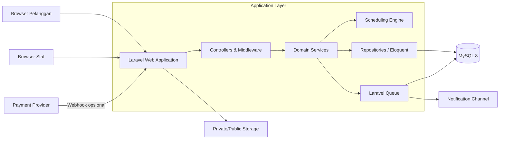
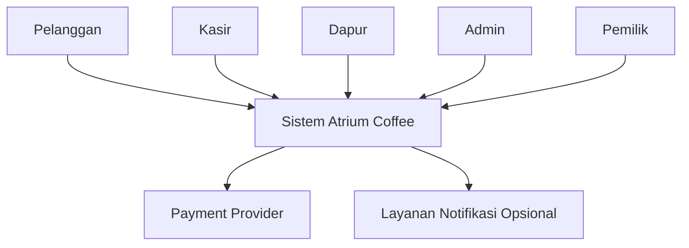
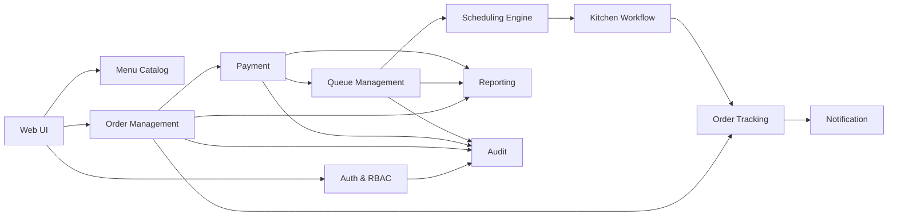
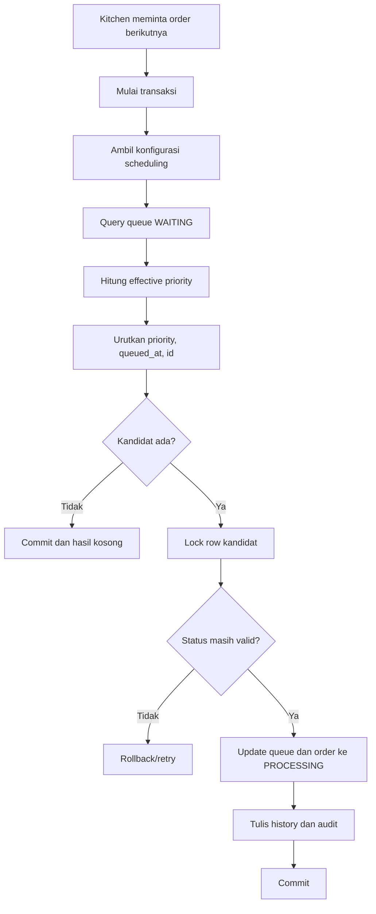
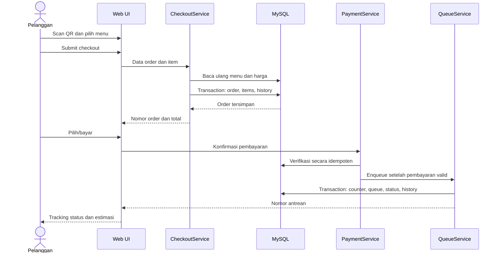
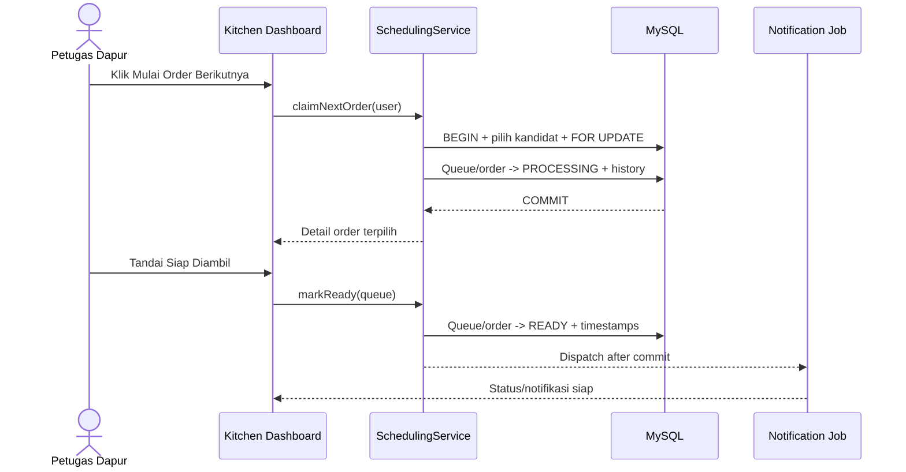
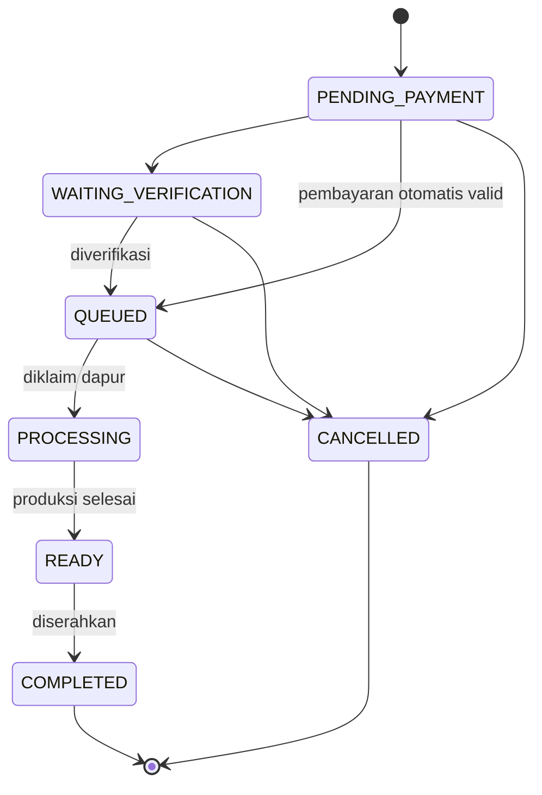
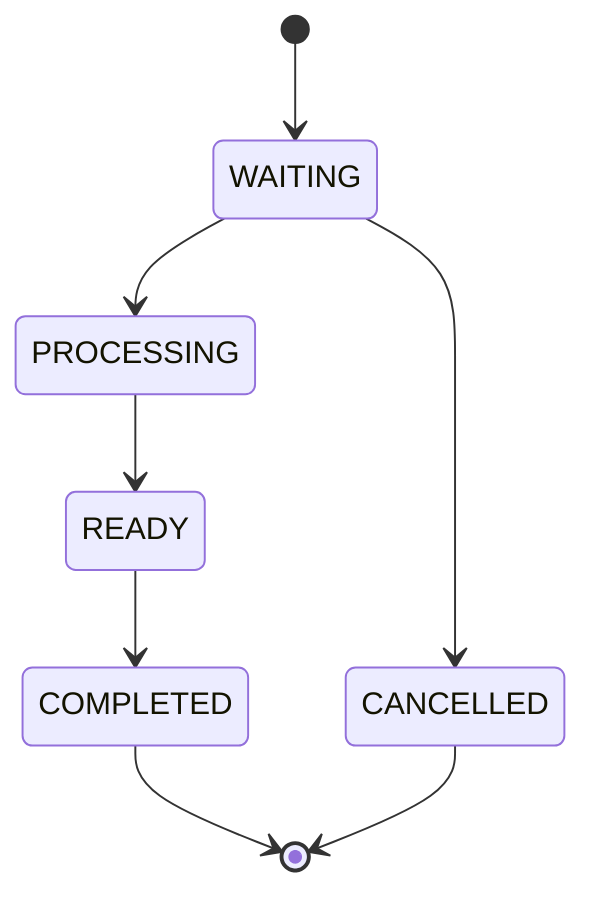
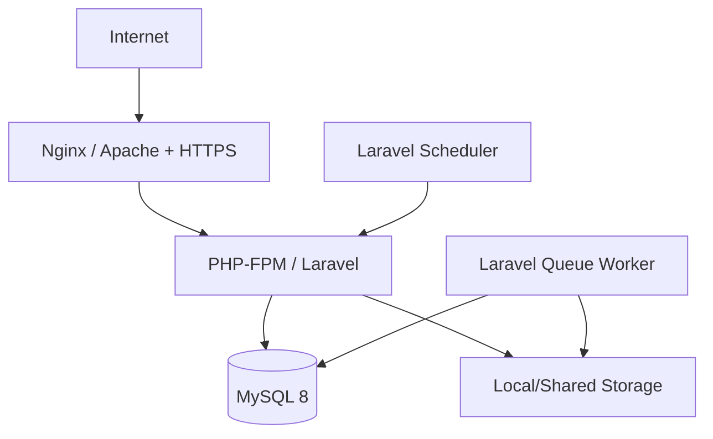

# System Design

## Sistem Pemesanan dan Antrean Berbasis Web Menggunakan Priority Scheduling pada Atrium Coffee

Dokumen ini menerjemahkan kebutuhan dalam `PRD.md`, `BUSINESS_RULES.md`, dan `desain_database.md` menjadi rancangan teknis aplikasi. Target implementasi adalah aplikasi web monolitik modular berbasis **Laravel, Blade, Tailwind CSS, Alpine.js, dan MySQL 8** yang sederhana untuk dioperasikan, aman terhadap konflik antrean, dan mudah dikembangkan.

## Daftar Isi

- [1. Ringkasan](#1-ringkasan)
- [2. Tujuan dan batasan](#2-tujuan-dan-batasan)
- [3. Prinsip desain](#3-prinsip-desain)
- [4. Arsitektur sistem](#4-arsitektur-sistem)
- [5. Konteks dan aktor](#5-konteks-dan-aktor)
- [6. Komponen aplikasi](#6-komponen-aplikasi)
- [7. Struktur kode Laravel](#7-struktur-kode-laravel)
- [8. Desain modul](#8-desain-modul)
- [9. Desain priority scheduling](#9-desain-priority-scheduling)
- [10. Alur utama sistem](#10-alur-utama-sistem)
- [11. State management](#11-state-management)
- [12. Desain API dan route](#12-desain-api-dan-route)
- [13. Data dan transaksi](#13-data-dan-transaksi)
- [14. Realtime dan notifikasi](#14-realtime-dan-notifikasi)
- [15. Keamanan](#15-keamanan)
- [16. Penanganan error](#16-penanganan-error)
- [17. Performa dan skalabilitas](#17-performa-dan-skalabilitas)
- [18. Observability dan audit](#18-observability-dan-audit)
- [19. Deployment](#19-deployment)
- [20. Pengujian](#20-pengujian)
- [21. Traceability](#21-traceability)
- [22. Risiko dan mitigasi](#22-risiko-dan-mitigasi)
- [23. Tahapan implementasi](#23-tahapan-implementasi)
- [24. Asumsi dan kebutuhan konfirmasi](#24-asumsi-dan-kebutuhan-konfirmasi)

## 1. Ringkasan

Sistem mendukung pemesanan melalui QR atau kasir, pembayaran, pembentukan nomor antrean, pemilihan order berdasarkan priority, proses dapur, tracking pelanggan, manajemen master data, dan laporan. Sistem menggunakan:

```text
Non-Preemptive Priority Scheduling
+ FCFS sebagai tie-breaker
+ Aging untuk mencegah starvation
```

Arsitektur yang direkomendasikan untuk MVP adalah **modular monolith**. Seluruh fungsi berjalan dalam satu aplikasi Laravel dan satu database MySQL, sedangkan background job menggunakan Laravel Queue. Pendekatan ini sesuai dengan skala coffee shop dan menghindari kompleksitas microservices yang belum diperlukan.

## 2. Tujuan dan batasan

### 2.1 Tujuan teknis

- Menyediakan satu sumber kebenaran bagi order, pembayaran, dan antrean.
- Menjamin satu order tidak diklaim dua petugas dapur.
- Menghasilkan urutan antrean yang deterministik dan dapat dijelaskan.
- Menjaga konsistensi status order dan queue.
- Memberikan tracking status dengan jeda rendah tanpa infrastruktur berlebihan.
- Menyimpan audit trail untuk tindakan operasional kritis.
- Mendukung pengembangan bertahap dari MVP ke versi lanjutan.

### 2.2 In scope

- Web responsif pelanggan, kasir, dapur, admin, dan pemilik.
- Authentication dan authorization berbasis role.
- Menu, kategori, order, item, pembayaran, antrean, scheduling, tracking, laporan, dan audit.
- Pembayaran tunai/manual dan struktur integrasi gateway.
- Polling status pada MVP serta jalur upgrade ke WebSocket.
- Export laporan sebagai fitur opsional.

### 2.3 Out of scope

- Delivery dan integrasi marketplace.
- Inventory bahan baku tingkat lanjut.
- Akuntansi, payroll, HR, dan loyalty program.
- Microservices dan event streaming terdistribusi.
- Optimasi multi-cabang.
- Penjadwalan per item atau per station pada MVP.

## 3. Prinsip desain

| Prinsip | Penerapan |
|---|---|
| Simplicity | Modular monolith, satu database, sedikit dependency operasional |
| Deterministic | Urutan queue selalu `effective_priority`, `queued_at`, lalu `id` |
| Server authoritative | Harga, total, priority, status, dan nomor antrean dihitung server |
| Transactional consistency | Perubahan order, queue, history, dan audit kritis dilakukan atomik |
| Least privilege | Setiap role hanya mengakses use case yang diizinkan |
| Explicit state transition | Perubahan status melalui domain service, bukan update bebas |
| Idempotency | Callback pembayaran dan submit checkout aman dari pengulangan |
| Auditability | Override priority, pembatalan, refund, konfigurasi, dan role dicatat |
| Progressive enhancement | Polling terlebih dahulu; WebSocket dapat ditambahkan tanpa mengubah domain |
| Testability | Algoritma dan service domain terpisah dari controller dan UI |

## 4. Arsitektur sistem

### 4.1 Diagram container



### 4.2 Logical layers

```text
Presentation
  Blade views, Alpine.js, Tailwind CSS, JSON endpoints
        ↓
Application
  Controllers, Form Requests, Jobs, Policies
        ↓
Domain
  OrderService, PaymentService, QueueService,
  SchedulingService, ReportingService
        ↓
Infrastructure
  Eloquent, MySQL, Cache, Queue Worker, Storage, Gateway Adapter
```

Controller hanya melakukan binding request, authorization, memanggil service, dan membentuk response. Aturan bisnis tidak diletakkan di Blade, JavaScript, atau controller.

### 4.3 Pilihan arsitektur

| Opsi | Keputusan | Alasan |
|---|---|---|
| Modular monolith | Dipilih | Cukup untuk satu coffee shop dan mudah dipelihara |
| REST internal | Dipilih seperlunya | Cocok untuk polling dan aksi UI tanpa SPA penuh |
| Repository kompleks | Tidak wajib | Eloquent + query object cukup untuk MVP |
| WebSocket | Fase lanjutan | Polling 3–5 detik lebih mudah dioperasikan |
| Redis | Opsional | Database queue/cache cukup untuk awal |
| Microservices | Tidak dipilih | Menambah deployment dan konsistensi terdistribusi |

## 5. Konteks dan aktor



| Aktor | Interface utama | Lingkup |
|---|---|---|
| Pelanggan | Web mobile melalui QR | Menu, cart, checkout, pembayaran, tracking |
| Kasir | Dashboard staf | Order walk-in, verifikasi pembayaran, pembatalan terbatas |
| Dapur | Kitchen display | Queue terurut, claim, proses, ready |
| Admin | Dashboard admin | Master data, user, scheduling configuration, audit |
| Pemilik | Dashboard laporan | Monitoring dan laporan read-oriented |

## 6. Komponen aplikasi



| Komponen | Tanggung jawab |
|---|---|
| Auth & RBAC | Login, session, role, policy, rate limiting |
| Menu Catalog | Kategori, menu, harga, availability, foto |
| Order Management | Cart validation, checkout, snapshot item, total, cancellation |
| Payment | Attempt, verifikasi, callback idempoten, refund |
| Queue Management | Nomor antrean, lifecycle queue, timestamp |
| Scheduling Engine | Base priority, aging, FCFS, pemilihan kandidat |
| Kitchen Workflow | Claim atomik, processing, ready, completed |
| Tracking | Status publik dengan tracking token dan estimasi |
| Notification | Web alert/outbox dan channel masa depan |
| Reporting | Penjualan, menu, antrean, performa |
| Audit | Catatan append-only untuk tindakan penting |
| Configuration | Parameter scheduling dan konfigurasi operasional |

## 7. Struktur kode Laravel

Struktur berikut menggunakan pola Laravel yang familiar tanpa membuat framework internal baru.

```text
app/
├── Enums/
│   ├── OrderStatus.php
│   ├── PaymentStatus.php
│   ├── QueueStatus.php
│   └── UserRole.php
├── Http/
│   ├── Controllers/
│   │   ├── Customer/
│   │   ├── Cashier/
│   │   ├── Kitchen/
│   │   ├── Admin/
│   │   └── Owner/
│   ├── Middleware/
│   └── Requests/
├── Jobs/
│   ├── SendOrderNotification.php
│   └── ProcessPaymentWebhook.php
├── Models/
├── Policies/
├── Queries/
│   ├── NextQueueQuery.php
│   └── SalesReportQuery.php
├── Services/
│   ├── AuditService.php
│   ├── CheckoutService.php
│   ├── OrderService.php
│   ├── PaymentService.php
│   ├── QueueService.php
│   ├── SchedulingService.php
│   └── ReportingService.php
└── Support/
    ├── Money.php
    └── OrderNumberGenerator.php
```

Ketentuan:

- Model berisi relasi, cast, scope sederhana, dan invariant lokal.
- Form Request menangani bentuk input; service menangani aturan lintas entitas.
- Enum menjadi sumber nilai status pada aplikasi.
- Policy mengatur otorisasi per aksi dan resource.
- Query object digunakan hanya untuk query scheduling/laporan yang kompleks.
- Side effect eksternal dikirim setelah transaksi database commit.

## 8. Desain modul

### 8.1 Authentication dan RBAC

- Laravel session authentication untuk pengguna internal.
- Pelanggan tamu menggunakan `tracking_token`, bukan login wajib.
- Role awal: `CASHIER`, `KITCHEN`, `ADMIN`, `OWNER`.
- Authorization diterapkan melalui middleware dan Policy.
- Akun nonaktif atau soft-deleted tidak dapat login.

### 8.2 Menu catalog

- Pelanggan hanya melihat kategori/menu aktif dan tersedia.
- Admin dapat mengubah availability tanpa menghapus histori.
- Harga di cart hanya preview; checkout membaca ulang harga database.
- Gambar disimpan pada filesystem/object storage; database menyimpan path.

### 8.3 Ordering dan checkout

Input checkout minimum:

```text
order_channel, order_type, dining_table/token,
customer identity, items[menu_id, quantity, notes], order notes
```

Alur service:

1. Validasi request dan QR/meja.
2. Muat menu aktif/tersedia dengan row yang relevan.
3. Tolak quantity kurang dari satu atau item duplikat yang ambigu.
4. Hitung ulang harga, subtotal, diskon, pajak, dan total di server.
5. Buat `orders`, snapshot `order_items`, dan history awal dalam transaksi.
6. Kembalikan `order_number`, `tracking_token`, total, dan instruksi pembayaran.

### 8.4 Payment

`PaymentService` menyediakan kontrak:

```text
createPayment(order, method)
verifyManualPayment(payment, cashier)
handleGatewayCallback(provider, payload)
refund(payment, amount, reason, actor)
```

- Callback diverifikasi signature-nya dan diproses idempoten.
- Payment sukses memperbarui `orders.payment_status` dan `paid_at`.
- Queue dibuat hanya setelah status pembayaran memenuhi kebijakan.
- Payload provider disanitasi sebelum disimpan.

### 8.5 Queue management

- `QueueService::enqueue()` memvalidasi kelayakan order.
- Nomor antrean harian dibuat menggunakan `daily_counters` yang dikunci.
- `queues.order_id` unik sehingga retry tidak membuat queue kedua.
- Status order dan queue berubah dalam transaksi yang sama.

### 8.6 Kitchen workflow

- Dashboard menampilkan current order dan kandidat berikutnya.
- Tombol **Mulai Proses** memanggil operasi claim, bukan menerima queue ID pilihan bebas dari UI.
- Server menghitung ulang kandidat terbaik saat request diterima.
- Dapur hanya dapat mengubah `PROCESSING → READY` pada order yang diklaim atau sesuai policy supervisor.
- Penyerahan order `READY → COMPLETED` dapat dilakukan kasir/dapur sesuai kebijakan final.

### 8.7 Admin dan owner

- Admin mengelola master data, user, role, scheduling setting, dan melihat audit.
- Perubahan konfigurasi kritis memerlukan re-authentication opsional dan audit.
- Owner bersifat read-oriented untuk dashboard dan laporan.
- Laporan cancelled tidak dihitung sebagai penjualan; refund mengurangi omzet bersih.

## 9. Desain priority scheduling

### 9.1 Aturan tunggal

1. Semua order normal memakai `base_priority = 3`.
2. Nilai lebih kecil berarti priority lebih tinggi.
3. Pelanggan tidak dapat menentukan priority.
4. Kandidat dipilih berdasarkan `effective_priority`.
5. Jika effective priority sama, `queued_at` paling awal menang.
6. Jika timestamp sama, `queues.id` terkecil menang.
7. Aging dievaluasi ketika scheduler mencari kandidat.
8. Scheduling bersifat non-preemptive.
9. Override manual memerlukan role berwenang, alasan, dan audit.
10. Claim dilakukan atomik agar satu queue hanya diproses satu worker.

### 9.2 Perhitungan aging

```text
waiting_minutes = floor(now - queued_at dalam menit)
aging_steps = floor(waiting_minutes / aging_interval_minutes)
effective_priority = max(minimum_priority, base_priority - aging_steps)
```

Default:

```text
default_priority = 3
minimum_priority = 1
maximum_priority = 3
aging_interval_minutes = 10
```

`base_priority` disimpan di database. `effective_priority` dihitung saat selection agar selalu sesuai waktu terkini dan tidak membutuhkan job pembaruan per menit.

### 9.3 Selection dan locking



Query menggunakan `SELECT ... FOR UPDATE SKIP LOCKED` pada MySQL 8. Query tidak boleh bergantung pada urutan yang sebelumnya ditampilkan di browser karena urutan dapat berubah akibat order baru atau aging.

### 9.4 Estimasi waktu tunggu

Untuk MVP satu station:

```text
estimated_wait = sisa estimasi order aktif
               + jumlah estimated_processing_minutes order yang berada di depan
```

Urutan "di depan" harus menggunakan scheduler yang sama. Estimasi disimpan sebagai snapshot untuk tampilan, tetapi dapat dihitung ulang saat tracking dimuat. Hasil diberi label perkiraan.

## 10. Alur utama sistem

### 10.1 Pemesanan pelanggan



### 10.2 Verifikasi pembayaran manual

1. Kasir membuka payment berstatus `PENDING`.
2. Policy memeriksa role dan payment terkait order valid.
3. Service mengunci row payment dan order.
4. Jika sudah `SUCCESS`, request dianggap idempoten.
5. Payment dan status agregat order diperbarui.
6. Queue dibuat satu kali dalam transaksi terkoordinasi.
7. History, audit, dan notifikasi dibuat.

### 10.3 Dapur memproses order



### 10.4 Pembatalan

- Sebelum pembayaran: pelanggan dapat membatalkan sesuai token dan status.
- Setelah pembayaran tetapi sebelum proses: memerlukan kasir/admin dan kebijakan refund.
- Setelah `PROCESSING`: bukan alur normal; hanya role berwenang dengan alasan.
- Setelah `READY`: secara default ditolak.
- Order dan queue, bila ada, dibatalkan secara atomik.

## 11. State management

### 11.1 State order



### 11.2 State queue



Semua transition melewati method eksplisit seperti `enqueue`, `claimNext`, `markReady`, `complete`, dan `cancel`. Endpoint generik `update status` tidak digunakan karena mudah melewati aturan bisnis.

## 12. Desain API dan route

MVP menggunakan web routes untuk halaman dan endpoint JSON ringan untuk polling/aksi. Semua endpoint mutasi memakai CSRF untuk session web.

### 12.1 Pelanggan

| Method | Route | Fungsi | Akses |
|---|---|---|---|
| GET | `/menu` | Daftar menu | Publik |
| GET | `/menu/{menu:slug}` | Detail menu | Publik |
| GET | `/table/{qrToken}` | Masuk dari QR meja | Publik |
| POST | `/checkout` | Membuat order | Publik + rate limit |
| GET | `/orders/track/{token}` | Halaman tracking | Token acak |
| GET | `/orders/track/{token}/status` | Polling status | Token acak + rate limit |
| POST | `/orders/track/{token}/cancel` | Batal sebelum batas status | Token + CSRF |

### 12.2 Kasir

| Method | Route | Fungsi |
|---|---|---|
| GET | `/cashier/orders` | Daftar order |
| POST | `/cashier/orders` | Order walk-in |
| GET | `/cashier/payments` | Payment menunggu verifikasi |
| POST | `/cashier/payments/{payment}/verify` | Verifikasi payment |
| POST | `/cashier/orders/{order}/cancel` | Pembatalan sesuai policy |
| POST | `/cashier/orders/{order}/complete` | Penyerahan order |

### 12.3 Dapur

| Method | Route | Fungsi |
|---|---|---|
| GET | `/kitchen` | Kitchen dashboard |
| GET | `/kitchen/queue` | Snapshot antrean terurut |
| POST | `/kitchen/queue/claim-next` | Klaim kandidat terbaik |
| POST | `/kitchen/queue/{queue}/ready` | Tandai siap |

### 12.4 Admin dan pemilik

Resource routes disediakan untuk kategori, menu, user, priority rule, dan setting. Laporan menggunakan query parameter `from`, `to`, dan filter yang divalidasi. Owner hanya mendapatkan GET/report export sesuai Policy.

### 12.5 Format response JSON

Sukses:

```json
{
  "data": {},
  "meta": {
    "request_id": "uuid"
  }
}
```

Gagal:

```json
{
  "message": "Pesanan tidak dapat diproses.",
  "code": "INVALID_ORDER_TRANSITION",
  "errors": {},
  "request_id": "uuid"
}
```

Pesan publik tidak membocorkan SQL, stack trace, token, atau konfigurasi internal.

## 13. Data dan transaksi

Skema fisik dan kamus data lengkap terdapat pada `desain_database.md`. Agregat utama:

```text
Order Aggregate
  orders
  order_items
  order_status_histories

Payment Aggregate
  payments
  refunds

Queue Aggregate
  queues
  queue_histories
  priority_change_logs
```

### 13.1 Transaction boundary

| Use case | Row yang dikunci/diperbarui |
|---|---|
| Generate nomor | `daily_counters` untuk tanggal dan tipe terkait |
| Verify payment | `payments`, `orders` |
| Enqueue | `orders`, `daily_counters`; insert `queues` dan history |
| Claim next | Satu kandidat `queues`, order terkait |
| Mark ready/complete | `queues`, `orders` |
| Override priority | `orders`, queue aktif, priority log |
| Refund | `payments`, order terkait; insert `refunds` |

### 13.2 Isolation dan deadlock

- Gunakan isolation default MySQL bila memadai dan row locking eksplisit.
- Selalu kunci row dalam urutan konsisten: order → payment/queue → counter/history.
- Transaksi dijaga singkat; network call tidak dilakukan di dalam transaksi.
- Deadlock/transient lock error dapat di-retry terbatas, misalnya maksimal tiga kali.
- Notifikasi dan webhook keluar dijalankan setelah commit.

### 13.3 Idempotency

| Operasi | Idempotency key/guard |
|---|---|
| Checkout | Token form sekali pakai atau `Idempotency-Key` opsional |
| Callback payment | `provider_reference`/event ID unik |
| Enqueue | UNIQUE `queues.order_id` |
| Nomor antrean | Counter terkunci + constraint unik harian |
| Claim | Conditional status `WAITING` + row lock |
| Ready/complete | Validasi current status |

## 14. Realtime dan notifikasi

### 14.1 MVP

- Pelanggan melakukan polling endpoint status setiap 5 detik.
- Kitchen dashboard melakukan polling setiap 3 detik.
- Response memakai `updated_at`/ETag sehingga payload dapat diminimalkan.
- Polling berhenti pada status terminal `COMPLETED` atau `CANCELLED`.
- Tab yang tidak aktif menurunkan frekuensi polling.

### 14.2 Versi lanjutan

Laravel Broadcasting + WebSocket dapat mengirim event:

```text
OrderQueued
OrderProcessing
OrderReady
OrderCompleted
OrderCancelled
QueueOrderChanged
```

Channel tracking pelanggan harus private/presence-safe dan menggunakan token/authorization. Event baru dipublikasikan setelah transaksi commit agar UI tidak membaca state yang belum tersimpan.

### 14.3 Outbox sederhana

Record `notifications` dibuat dalam transaksi domain, kemudian worker mengirimkannya. Retry menggunakan exponential backoff dan batas percobaan. Kegagalan notifikasi tidak boleh membatalkan status order yang sudah valid.

## 15. Keamanan

### 15.1 Authentication dan session

- Password di-hash menggunakan algoritma default Laravel yang aman.
- Session cookie memakai `HttpOnly`, `Secure` di production, dan `SameSite=Lax` atau lebih ketat.
- Session diregenerasi setelah login dan dihentikan saat logout/nonaktif.
- Login diberi rate limit dan kegagalan penting dicatat.

### 15.2 Authorization

| Aksi | Pelanggan | Kasir | Dapur | Admin | Pemilik |
|---|---:|---:|---:|---:|---:|
| Membuat order | Ya | Ya | Tidak | Opsional | Tidak |
| Verifikasi payment | Tidak | Ya | Tidak | Ya | Tidak |
| Klaim order berikutnya | Tidak | Tidak | Ya | Opsional | Tidak |
| Tandai ready | Tidak | Tidak | Ya | Opsional | Tidak |
| Override priority | Tidak | Terbatas | Tidak | Ya | Tidak |
| Konfigurasi scheduling | Tidak | Tidak | Tidak | Ya | Tidak |
| Lihat laporan | Riwayat sendiri | Operasional | Operasional | Ya | Ya |
| Lihat audit log | Tidak | Tidak | Tidak | Ya | Read-only opsional |

### 15.3 Application security

- CSRF protection pada semua mutasi berbasis session.
- Blade escaping default untuk mencegah XSS; HTML pelanggan tidak dirender mentah.
- Query menggunakan Eloquent/query binding untuk mencegah SQL injection.
- Upload gambar memvalidasi MIME, ukuran, ekstensi, dan nama file acak.
- Mass assignment dibatasi dengan DTO/validated data dan `$fillable` yang ketat.
- Tracking publik memakai token acak 256-bit, bukan order ID.
- Error production tidak menampilkan stack trace.
- Header keamanan: CSP bertahap, `X-Content-Type-Options`, frame protection, dan HTTPS.
- Webhook memverifikasi signature, timestamp, serta replay/idempotency.

### 15.4 Data protection

- Data kartu atau credential payment tidak disimpan.
- PII dibatasi pada kebutuhan operasi.
- Export laporan memerlukan authorization dan dicatat.
- Log disanitasi dari password, token, cookie, dan payload sensitif.

## 16. Penanganan error

| Kode | Kondisi | HTTP | Respons sistem |
|---|---|---:|---|
| `MENU_UNAVAILABLE` | Menu habis/nonaktif | 422 | Tolak checkout dan tampilkan item terkait |
| `PRICE_CHANGED` | Harga berubah sejak cart | 409 | Tampilkan total baru dan minta konfirmasi |
| `DUPLICATE_ORDER` | Submit checkout diulang | 409/200 | Kembalikan order yang sama bila idempoten |
| `PAYMENT_NOT_VALID` | Pembayaran belum memenuhi syarat | 422 | Jangan membuat queue |
| `DUPLICATE_PAYMENT_EVENT` | Callback sudah diproses | 200 | Tidak mengubah state kedua kali |
| `INVALID_ORDER_TRANSITION` | Status tujuan ilegal | 409 | Pertahankan state dan catat bila mencurigakan |
| `QUEUE_CLAIM_CONFLICT` | Kandidat diklaim worker lain | 409/retry | Hitung ulang kandidat |
| `INVALID_PRIORITY` | Di luar range | 422 | Tolak perubahan |
| `UNAUTHORIZED_PRIORITY_OVERRIDE` | Aktor tidak berhak | 403 | Tolak dan audit bila perlu |
| `ORDER_NOT_FOUND` | Token/ID tidak valid | 404 | Tidak mengungkap keberadaan data lain |
| `PAYMENT_PROVIDER_UNAVAILABLE` | Gateway gagal | 503 | Simpan pending, retry aman, jangan enqueue |
| `DATABASE_UNAVAILABLE` | Database gagal | 503 | Rollback dan tampilkan request ID |

UX tidak boleh menyatakan pembayaran gagal apabila status sebenarnya belum diketahui. Gunakan status `PENDING` dan rekonsiliasi.

## 17. Performa dan skalabilitas

### 17.1 Target MVP

| Area | Target awal |
|---|---|
| Halaman menu | p95 ≤ 2 detik pada koneksi normal |
| Aksi dashboard lokal | p95 ≤ 1 detik, di luar layanan eksternal |
| Claim queue | p95 ≤ 500 ms pada antrean operasional normal |
| Polling status | Payload ringkas, respons p95 ≤ 500 ms |
| Ketersediaan | Target operasional 99% selama jam buka |

### 17.2 Strategi

- Eager loading untuk menghindari N+1 query.
- Pagination pada order, audit log, dan laporan rinci.
- Indeks mengikuti `desain_database.md`.
- Cache menu/kategori singkat; invalidasi saat admin mengubah master.
- Queue worker untuk notifikasi dan export.
- Query scheduling hanya memindai queue `WAITING`.
- Report besar dijalankan async dan file memiliki masa berlaku.

### 17.3 Jalur scale-up

1. Tambahkan Redis untuk cache, session, dan queue.
2. Jalankan beberapa web worker di belakang reverse proxy.
3. Gunakan shared object storage untuk gambar/export.
4. Tambahkan read replica hanya jika laporan membebani transaksi.
5. Tambahkan `kitchen_stations` jika proses benar-benar dibagi per station.

## 18. Observability dan audit

### 18.1 Structured logging

Setiap log aplikasi menyertakan bila tersedia:

```text
timestamp, level, environment, request_id,
user_id, order_id, queue_id, action, duration_ms
```

### 18.2 Audit event wajib

- Perubahan status order/queue penting.
- Verifikasi pembayaran dan refund.
- Pembatalan.
- Manual priority override.
- Perubahan harga dan availability.
- Perubahan setting scheduling.
- Perubahan role atau status akun.
- Export laporan sensitif.

### 18.3 Health checks dan alert

- `/up` memeriksa proses aplikasi; readiness dapat memeriksa database.
- Monitor error rate, waktu respons, queue job gagal, payment pending terlalu lama, dan order overdue.
- Alert operasional penting: database tidak tersedia, worker berhenti, callback payment gagal berulang, dan backup gagal.

## 19. Deployment

### 19.1 Topologi MVP



Untuk lingkungan Windows/Laragon pengembangan, komponen dapat berjalan pada satu mesin. Production sebaiknya menggunakan process supervisor untuk queue worker dan cron setiap menit untuk `php artisan schedule:run`.

### 19.2 Environment

| Environment | Tujuan | Data |
|---|---|---|
| Local | Pengembangan | Seed sintetis |
| Testing | Automated test | Database disposable |
| Staging | UAT dan simulasi operasional | Data anonim/sintetis |
| Production | Operasional | Data nyata dan backup |

### 19.3 Deployment flow

1. Build dependency dan frontend asset secara reproducible.
2. Jalankan test otomatis.
3. Backup database sebelum migration berisiko.
4. Aktifkan maintenance hanya bila migration tidak kompatibel.
5. Jalankan migration dengan akun berwenang.
6. Deploy application dan restart worker secara graceful.
7. Jalankan smoke test menu, login, checkout, dan health check.
8. Sediakan rollback aplikasi; migration destruktif dilakukan bertahap.

## 20. Pengujian

### 20.1 Test pyramid

| Level | Fokus |
|---|---|
| Unit | Aging, comparator scheduling, kalkulasi total, state transition |
| Feature | Route, authorization, checkout, payment, enqueue, kitchen workflow |
| Integration | MySQL locking, idempotent callback, storage, notification job |
| Browser/E2E | QR → order → payment → queue → ready → completed |
| Load | Polling dashboard, checkout bersamaan, claim queue |

### 20.2 Kasus scheduling wajib

1. Priority berbeda menghasilkan urutan priority terkecil lebih dahulu.
2. Priority sama memakai `queued_at` paling awal.
3. Priority dan `queued_at` sama memakai `id` terkecil.
4. Aging menaikkan effective priority tanpa mengubah base priority.
5. Effective priority tidak pernah melewati minimum.
6. Order baru berpriority tinggi tidak menghentikan order `PROCESSING`.
7. Dua request claim bersamaan memperoleh order berbeda atau satu hasil konflik aman.
8. Queue cancelled dan non-WAITING tidak menjadi kandidat.
9. Perubahan interval aging memengaruhi selection berikutnya, bukan histori selesai.
10. Override manual selalu memiliki log dan alasan.

### 20.3 Kasus transaksi wajib

- Dua callback payment identik hanya menghasilkan satu efek.
- Dua enqueue untuk order sama hanya menghasilkan satu queue.
- Dua nomor antrean bersamaan tetap unik.
- Kegagalan insert history me-rollback perubahan status.
- Kegagalan notifikasi setelah commit tidak me-rollback order.
- Harga berubah setelah cart menyebabkan rekalkulasi server.
- Order selesai/cancelled tidak dapat diedit.

## 21. Traceability

| Kebutuhan | Komponen | Data utama | Verifikasi |
|---|---|---|---|
| Pemesanan QR | Menu, Checkout | orders, order_items, dining_tables | Feature + E2E test |
| Pembayaran | PaymentService | payments, refunds | Integration test |
| Nomor antrean | QueueService | daily_counters, queues | Concurrency test |
| Priority Scheduling | SchedulingService | queues, settings | Unit + integration test |
| FCFS | NextQueueQuery | queued_at, id | Unit test |
| Aging | SchedulingService | base_priority, queued_at | Unit test berbasis clock |
| Proses dapur | Kitchen workflow | orders, queues, histories | Feature test |
| Tracking | Tracking controller | order, queue, notification | Feature/E2E test |
| Override priority | Admin/Cashier policy | priority_change_logs, audit_logs | Authorization test |
| Laporan | ReportingService | order_items, payments, queues | Query test |

## 22. Risiko dan mitigasi

| Risiko | Dampak | Mitigasi |
|---|---|---|
| Race condition claim | Order diproses dua kali | Row lock, conditional update, transaksi |
| Starvation | Order normal menunggu terlalu lama | Aging dan overdue monitoring |
| Manipulasi harga/priority | Kerugian dan antrean tidak adil | Server authority, Policy, audit |
| Status order/queue berbeda | UI dan laporan salah | Satu domain service dan transaksi atomik |
| Duplicate payment callback | Pembayaran/queue ganda | Signature, unique reference, idempotency |
| Polling berlebihan | Beban server | Interval wajar, ETag, pause tab pasif, cache |
| Koneksi kedai putus | Operasi tertunda | Error retry aman, status pending, prosedur manual |
| Konfigurasi salah | Urutan antrean tidak sesuai | Validasi range, audit, default aman |
| Laporan lambat | Dashboard pemilik terganggu | Indeks, pagination, async export, summary kemudian |
| Data sensitif bocor di log | Risiko privasi | Sanitasi dan access control log |

## 23. Tahapan implementasi

### Phase 1 — Foundation

- Setup Laravel, environment, authentication, role/policy.
- Migration database, model, enum, seeder, dan audit dasar.
- CI test dan standar error response.

### Phase 2 — Menu dan ordering

- Kategori/menu, QR, cart, checkout, snapshot harga.
- Tracking token dan halaman status awal.

### Phase 3 — Payment dan queue

- Pembayaran manual/gateway adapter.
- Nomor order/queue atomik, enqueue, status history.
- SchedulingService, FCFS, aging, dan test concurrency.

### Phase 4 — Dashboard operasional

- Dashboard kasir dan dapur.
- Claim next, ready, completed, cancellation terbatas.
- Polling dan notifikasi web.

### Phase 5 — Admin dan owner

- User/menu/settings/priority rule management.
- Dashboard ringkasan dan audit log.

### Phase 6 — Reporting dan hardening

- Laporan penjualan, menu, antrean, dan export opsional.
- Load test, backup/restore test, security review, dan UAT.

## 24. Asumsi dan kebutuhan konfirmasi

### 24.1 Asumsi

- Satu order mempunyai satu queue produksi.
- Terdapat satu workflow/station dapur utama pada MVP.
- Pembayaran valid sebelum masuk queue.
- Priority berada pada rentang 1–3 dengan default 3.
- Aging interval awal 10 menit.
- Keranjang pelanggan disimpan di session/browser sebelum checkout.
- Polling cukup untuk kebutuhan realtime awal.
- Status produksi diterapkan per order, bukan per item.

### 24.2 Needs Confirmation

| Pertanyaan | Dampak desain |
|---|---|
| QR per meja atau QR umum? | Validasi dan penggunaan `dining_tables` |
| Metode payment apa saja? | Adapter, webhook, settlement, dan UI kasir |
| Berapa kitchen station? | Claim global atau queue/station terpisah |
| Makanan dan minuman satu queue? | Scheduling per order atau per item/station |
| Siapa yang menandai completed? | Policy kasir/dapur |
| Kategori resmi priority 1 dan 2? | Rule engine, opsi kasir, dan laporan |
| Kebijakan pembatalan dan refund? | State exception dan alur approval |
| Akun pelanggan diperlukan? | Authentication dan histori pelanggan |
| Berapa interval aging final? | Configuration seed dan acceptance test |
| Perlu WhatsApp/SMS? | Provider, consent, biaya, retry, dan retensi data |

Selama belum dikonfirmasi, implementasi mengikuti asumsi MVP di atas. Keputusan yang mengubah satu queue menjadi multi-station sebaiknya diselesaikan sebelum modul antrean diimplementasikan karena berdampak pada skema dan algoritma claim.
