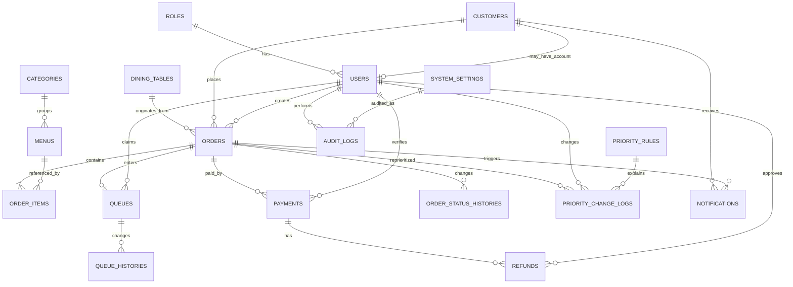

# Desain Database

## Sistem Pemesanan dan Antrean Berbasis Web Atrium Coffee

Dokumen ini menerjemahkan kebutuhan pada `PRD.md` dan `BUSINESS_RULES.md` menjadi rancangan basis data relasional untuk **MySQL 8** dan aplikasi **Laravel**. Rancangan memprioritaskan konsistensi transaksi, keterlacakan perubahan, dan implementasi **Non-Preemptive Priority Scheduling + FCFS + Aging**.

## Daftar Isi

- [1. Tujuan dan ruang lingkup](#1-tujuan-dan-ruang-lingkup)
- [2. Keputusan desain](#2-keputusan-desain)
- [3. Konvensi](#3-konvensi)
- [4. Diagram ERD](#4-diagram-erd)
- [5. Kamus data](#5-kamus-data)
- [6. Relasi dan kardinalitas](#6-relasi-dan-kardinalitas)
- [7. Constraint dan validasi](#7-constraint-dan-validasi)
- [8. Indeks](#8-indeks)
- [9. Implementasi priority scheduling](#9-implementasi-priority-scheduling)
- [10. Transaksi dan concurrency](#10-transaksi-dan-concurrency)
- [11. Sinkronisasi status](#11-sinkronisasi-status)
- [12. Pelaporan](#12-pelaporan)
- [13. Retensi, keamanan, dan backup](#13-retensi-keamanan-dan-backup)
- [14. Urutan migration Laravel](#14-urutan-migration-laravel)
- [15. Asumsi dan kebutuhan konfirmasi](#15-asumsi-dan-kebutuhan-konfirmasi)

## 1. Tujuan dan ruang lingkup

Database mendukung:

- akun internal dan pelanggan terdaftar;
- role-based access control;
- kategori dan menu digital;
- QR meja atau QR umum;
- order dan snapshot harga item;
- pembayaran, verifikasi, dan refund dasar;
- satu antrean produksi untuk setiap order;
- priority scheduling, FCFS, aging, dan override beralasan;
- histori status, notifikasi, konfigurasi, dan audit log;
- data operasional untuk laporan penjualan dan antrean.

Keranjang sebelum checkout disimpan di session/browser untuk MVP. Karena itu tabel `carts` tidak wajib. Jika keranjang lintas perangkat diperlukan, tabel tersebut dapat ditambahkan pada fase lanjutan.

## 2. Keputusan desain

| Keputusan | Rancangan |
|---|---|
| DBMS | MySQL 8, InnoDB, `utf8mb4` |
| Primary key | `BIGINT UNSIGNED AUTO_INCREMENT` |
| Nilai uang | `DECIMAL(15,2)`, tidak menggunakan floating point |
| Zona waktu | Simpan timestamp dalam UTC; tampilkan dalam `Asia/Makassar` |
| Status | `VARCHAR` dengan validasi aplikasi dan `CHECK`; lebih mudah dimigrasikan daripada `ENUM` |
| Penghapusan master | Soft delete untuk user, customer, kategori, dan menu |
| Penghapusan transaksi | Order, payment, queue, history, dan audit log tidak dihapus secara fisik |
| Nomor publik | `order_number` dan `queue_number`, terpisah dari primary key |
| Antrean | Tepat satu record `queues` per order pada MVP |
| Priority | `base_priority` disimpan; `effective_priority` dihitung saat memilih antrean berikutnya |
| Aging | Interval dan batas priority diambil dari konfigurasi aktif |
| Scheduling | Non-preemptive; order yang sudah `PROCESSING` tidak digantikan order baru |
| Histori | Perubahan status dan priority disimpan append-only |
| Laporan | Dihitung dari tabel transaksi; materialized summary belum diperlukan untuk MVP |

## 3. Konvensi

### 3.1 Penamaan

- Nama tabel dan kolom menggunakan `snake_case` bahasa Inggris.
- Foreign key berbentuk `<entity>_id`.
- Semua tabel utama memiliki `created_at` dan `updated_at`, kecuali tabel append-only yang cukup memiliki `created_at`.
- Kolom waktu kejadian menggunakan nama eksplisit, misalnya `queued_at`, `paid_at`, dan `ready_at`.

### 3.2 Kode status

| Domain | Nilai yang diizinkan |
|---|---|
| `orders.status` | `PENDING_PAYMENT`, `WAITING_VERIFICATION`, `QUEUED`, `PROCESSING`, `READY`, `COMPLETED`, `CANCELLED` |
| `orders.payment_status` | `UNPAID`, `PENDING`, `PAID`, `FAILED`, `PARTIALLY_REFUNDED`, `REFUNDED` |
| `queues.status` | `WAITING`, `PROCESSING`, `READY`, `COMPLETED`, `CANCELLED` |
| `payments.status` | `PENDING`, `SUCCESS`, `FAILED`, `EXPIRED`, `REFUNDED`, `PARTIALLY_REFUNDED` |
| `notifications.status` | `PENDING`, `SENT`, `READ`, `FAILED` |

Nilai status didefinisikan sebagai constant/enum pada kode Laravel agar tidak tersebar sebagai string bebas.

## 4. Diagram ERD



Catatan: relasi terakhir bersifat konseptual. `audit_logs.entity_type` dan `entity_id` merupakan relasi polimorfik sehingga tidak menggunakan foreign key fisik.

## 5. Kamus data

### 5.1 `roles`

Master role pengguna internal.

| Kolom | Tipe | Null | Constraint/keterangan |
|---|---|---:|---|
| `id` | BIGINT UNSIGNED | Tidak | PK |
| `code` | VARCHAR(30) | Tidak | UNIQUE; `CASHIER`, `KITCHEN`, `ADMIN`, `OWNER` |
| `name` | VARCHAR(60) | Tidak | Nama tampilan |
| `description` | VARCHAR(255) | Ya | Penjelasan role |
| `created_at` | TIMESTAMP | Ya | Laravel timestamp |
| `updated_at` | TIMESTAMP | Ya | Laravel timestamp |

Hak akses detail direkomendasikan menggunakan Laravel Policy/Gate. Tabel permission baru diperlukan apabila hak akses harus dikonfigurasi lewat UI.

### 5.2 `customers`

Identitas pelanggan, termasuk pelanggan tamu.

| Kolom | Tipe | Null | Constraint/keterangan |
|---|---|---:|---|
| `id` | BIGINT UNSIGNED | Tidak | PK |
| `name` | VARCHAR(100) | Tidak | Nama pelanggan/tamu |
| `phone` | VARCHAR(25) | Ya | INDEX; format ternormalisasi |
| `email` | VARCHAR(150) | Ya | INDEX |
| `is_guest` | BOOLEAN | Tidak | DEFAULT true |
| `created_at` | TIMESTAMP | Ya | |
| `updated_at` | TIMESTAMP | Ya | |
| `deleted_at` | TIMESTAMP | Ya | Soft delete |

Email/telepon tidak wajib unik karena data tamu bisa tidak terverifikasi. Keunikan akun diterapkan pada `users.email`.

### 5.3 `users`

Akun login staf, pemilik, dan pelanggan terdaftar jika fitur akun pelanggan diaktifkan.

| Kolom | Tipe | Null | Constraint/keterangan |
|---|---|---:|---|
| `id` | BIGINT UNSIGNED | Tidak | PK |
| `role_id` | BIGINT UNSIGNED | Tidak | FK → `roles.id`, RESTRICT |
| `customer_id` | BIGINT UNSIGNED | Ya | FK → `customers.id`, SET NULL, UNIQUE |
| `name` | VARCHAR(100) | Tidak | |
| `email` | VARCHAR(150) | Tidak | UNIQUE |
| `password` | VARCHAR(255) | Tidak | Hash, tidak pernah plaintext |
| `is_active` | BOOLEAN | Tidak | DEFAULT true |
| `last_login_at` | TIMESTAMP | Ya | |
| `remember_token` | VARCHAR(100) | Ya | Laravel |
| `created_at` | TIMESTAMP | Ya | |
| `updated_at` | TIMESTAMP | Ya | |
| `deleted_at` | TIMESTAMP | Ya | Soft delete |

### 5.4 `categories`

Master kategori menu.

| Kolom | Tipe | Null | Constraint/keterangan |
|---|---|---:|---|
| `id` | BIGINT UNSIGNED | Tidak | PK |
| `name` | VARCHAR(100) | Tidak | UNIQUE |
| `slug` | VARCHAR(120) | Tidak | UNIQUE |
| `description` | VARCHAR(255) | Ya | |
| `sort_order` | SMALLINT UNSIGNED | Tidak | DEFAULT 0 |
| `is_active` | BOOLEAN | Tidak | DEFAULT true |
| `created_at` | TIMESTAMP | Ya | |
| `updated_at` | TIMESTAMP | Ya | |
| `deleted_at` | TIMESTAMP | Ya | Soft delete |

### 5.5 `menus`

Master produk makanan/minuman.

| Kolom | Tipe | Null | Constraint/keterangan |
|---|---|---:|---|
| `id` | BIGINT UNSIGNED | Tidak | PK |
| `category_id` | BIGINT UNSIGNED | Tidak | FK → `categories.id`, RESTRICT |
| `sku` | VARCHAR(40) | Tidak | UNIQUE |
| `name` | VARCHAR(120) | Tidak | |
| `description` | TEXT | Ya | |
| `price` | DECIMAL(15,2) | Tidak | CHECK `price >= 0` |
| `estimated_prep_minutes` | SMALLINT UNSIGNED | Tidak | DEFAULT 5, CHECK > 0 |
| `image_path` | VARCHAR(500) | Ya | Path/URL, bukan blob |
| `is_available` | BOOLEAN | Tidak | DEFAULT true |
| `is_active` | BOOLEAN | Tidak | DEFAULT true |
| `created_at` | TIMESTAMP | Ya | |
| `updated_at` | TIMESTAMP | Ya | |
| `deleted_at` | TIMESTAMP | Ya | Soft delete |

### 5.6 `dining_tables`

Sumber QR untuk meja. Dapat dinonaktifkan jika Atrium Coffee memakai QR umum.

| Kolom | Tipe | Null | Constraint/keterangan |
|---|---|---:|---|
| `id` | BIGINT UNSIGNED | Tidak | PK |
| `code` | VARCHAR(30) | Tidak | UNIQUE; contoh `T01` |
| `name` | VARCHAR(60) | Tidak | Contoh `Meja 01` |
| `qr_token` | CHAR(64) | Tidak | UNIQUE; token acak/hash, bukan ID berurutan |
| `is_active` | BOOLEAN | Tidak | DEFAULT true |
| `created_at` | TIMESTAMP | Ya | |
| `updated_at` | TIMESTAMP | Ya | |

### 5.7 `orders`

Header transaksi dan sumber kebenaran status order.

| Kolom | Tipe | Null | Constraint/keterangan |
|---|---|---:|---|
| `id` | BIGINT UNSIGNED | Tidak | PK |
| `order_number` | VARCHAR(30) | Tidak | UNIQUE; contoh `ORD-20260830-0001` |
| `tracking_token` | CHAR(64) | Tidak | UNIQUE; akses tracking tamu |
| `customer_id` | BIGINT UNSIGNED | Ya | FK → `customers.id`, SET NULL |
| `created_by_user_id` | BIGINT UNSIGNED | Ya | FK → `users.id`, SET NULL; kasir atau sistem |
| `dining_table_id` | BIGINT UNSIGNED | Ya | FK → `dining_tables.id`, SET NULL |
| `order_channel` | VARCHAR(20) | Tidak | `QR`, `CASHIER` |
| `order_type` | VARCHAR(20) | Tidak | `DINE_IN`, `TAKEAWAY` |
| `customer_name_snapshot` | VARCHAR(100) | Tidak | Tetap tersedia bila customer berubah |
| `subtotal` | DECIMAL(15,2) | Tidak | CHECK >= 0 |
| `discount_amount` | DECIMAL(15,2) | Tidak | DEFAULT 0, CHECK >= 0 |
| `tax_amount` | DECIMAL(15,2) | Tidak | DEFAULT 0, CHECK >= 0 |
| `total_amount` | DECIMAL(15,2) | Tidak | CHECK >= 0 |
| `status` | VARCHAR(30) | Tidak | Status order pada §3.2 |
| `payment_status` | VARCHAR(30) | Tidak | Status agregat pembayaran |
| `base_priority` | TINYINT UNSIGNED | Tidak | DEFAULT 3, CHECK 1–3 |
| `estimated_processing_minutes` | SMALLINT UNSIGNED | Tidak | Snapshot estimasi order, CHECK > 0 |
| `notes` | VARCHAR(500) | Ya | Catatan umum pelanggan |
| `ordered_at` | TIMESTAMP | Tidak | Waktu order dikonfirmasi |
| `paid_at` | TIMESTAMP | Ya | Waktu pembayaran valid |
| `cancelled_at` | TIMESTAMP | Ya | |
| `cancel_reason` | VARCHAR(500) | Ya | Wajib jika dibatalkan |
| `cancelled_by_user_id` | BIGINT UNSIGNED | Ya | FK → `users.id`, SET NULL |
| `created_at` | TIMESTAMP | Ya | |
| `updated_at` | TIMESTAMP | Ya | |

`total_amount = subtotal - discount_amount + tax_amount` wajib dihitung server-side. Validasi lintas kolom dilakukan pada service layer dan dapat diperkuat dengan `CHECK`.

### 5.8 `order_items`

Detail item sekaligus snapshot produk saat checkout.

| Kolom | Tipe | Null | Constraint/keterangan |
|---|---|---:|---|
| `id` | BIGINT UNSIGNED | Tidak | PK |
| `order_id` | BIGINT UNSIGNED | Tidak | FK → `orders.id`, CASCADE hanya sebelum finalisasi |
| `menu_id` | BIGINT UNSIGNED | Ya | FK → `menus.id`, SET NULL |
| `menu_name_snapshot` | VARCHAR(120) | Tidak | Nama saat transaksi |
| `unit_price` | DECIMAL(15,2) | Tidak | Snapshot harga, CHECK >= 0 |
| `quantity` | SMALLINT UNSIGNED | Tidak | CHECK >= 1 |
| `subtotal` | DECIMAL(15,2) | Tidak | `unit_price × quantity` |
| `estimated_prep_minutes` | SMALLINT UNSIGNED | Tidak | Snapshot estimasi item |
| `notes` | VARCHAR(500) | Ya | Catatan item |
| `created_at` | TIMESTAMP | Ya | |
| `updated_at` | TIMESTAMP | Ya | |

Order yang telah dibayar tidak boleh kehilangan item akibat penghapusan menu; karena itu snapshot wajib dan `menu_id` boleh null.

### 5.9 `payments`

Percobaan dan hasil pembayaran. Satu order dapat memiliki beberapa percobaan pembayaran, tetapi jumlah pembayaran sukses bersih tidak boleh melampaui total order.

| Kolom | Tipe | Null | Constraint/keterangan |
|---|---|---:|---|
| `id` | BIGINT UNSIGNED | Tidak | PK |
| `order_id` | BIGINT UNSIGNED | Tidak | FK → `orders.id`, RESTRICT |
| `payment_number` | VARCHAR(40) | Tidak | UNIQUE |
| `method` | VARCHAR(30) | Tidak | `CASH`, `QRIS`, `TRANSFER`, dll. |
| `provider` | VARCHAR(60) | Ya | Payment gateway/bank |
| `provider_reference` | VARCHAR(100) | Ya | UNIQUE bila tersedia |
| `amount` | DECIMAL(15,2) | Tidak | CHECK > 0 |
| `status` | VARCHAR(30) | Tidak | Status payment pada §3.2 |
| `paid_at` | TIMESTAMP | Ya | Wajib jika `SUCCESS` |
| `verified_at` | TIMESTAMP | Ya | |
| `verified_by_user_id` | BIGINT UNSIGNED | Ya | FK → `users.id`, SET NULL |
| `failure_reason` | VARCHAR(500) | Ya | |
| `raw_response` | JSON | Ya | Respons gateway yang disanitasi; tanpa data rahasia |
| `created_at` | TIMESTAMP | Ya | |
| `updated_at` | TIMESTAMP | Ya | |

Idempotensi callback menggunakan `provider_reference` atau tabel `payment_webhook_events` opsional jika gateway menyertakan event ID terpisah.

### 5.10 `refunds`

Mencatat refund penuh pada MVP dan siap mendukung partial refund kemudian.

| Kolom | Tipe | Null | Constraint/keterangan |
|---|---|---:|---|
| `id` | BIGINT UNSIGNED | Tidak | PK |
| `payment_id` | BIGINT UNSIGNED | Tidak | FK → `payments.id`, RESTRICT |
| `refund_number` | VARCHAR(40) | Tidak | UNIQUE |
| `amount` | DECIMAL(15,2) | Tidak | CHECK > 0; total refund ≤ payment sukses |
| `status` | VARCHAR(20) | Tidak | `PENDING`, `SUCCESS`, `FAILED` |
| `reason` | VARCHAR(500) | Tidak | Wajib |
| `approved_by_user_id` | BIGINT UNSIGNED | Tidak | FK → `users.id`, RESTRICT |
| `provider_reference` | VARCHAR(100) | Ya | UNIQUE bila tersedia |
| `refunded_at` | TIMESTAMP | Ya | |
| `created_at` | TIMESTAMP | Ya | |
| `updated_at` | TIMESTAMP | Ya | |

### 5.11 `queues`

State antrean produksi saat ini. Satu order hanya boleh mempunyai satu queue.

| Kolom | Tipe | Null | Constraint/keterangan |
|---|---|---:|---|
| `id` | BIGINT UNSIGNED | Tidak | PK; deterministic tie-breaker |
| `order_id` | BIGINT UNSIGNED | Tidak | FK → `orders.id`, RESTRICT, UNIQUE |
| `queue_date` | DATE | Tidak | Tanggal operasional lokal |
| `sequence_number` | INT UNSIGNED | Tidak | Nomor urut harian |
| `queue_number` | VARCHAR(20) | Tidak | Contoh `A001` |
| `base_priority` | TINYINT UNSIGNED | Tidak | Snapshot priority aktif, CHECK 1–3 |
| `status` | VARCHAR(20) | Tidak | Status queue pada §3.2 |
| `queued_at` | TIMESTAMP | Tidak | Dasar FCFS dan aging |
| `claimed_by_user_id` | BIGINT UNSIGNED | Ya | FK → `users.id`, SET NULL |
| `processing_started_at` | TIMESTAMP | Ya | |
| `ready_at` | TIMESTAMP | Ya | |
| `completed_at` | TIMESTAMP | Ya | |
| `cancelled_at` | TIMESTAMP | Ya | |
| `estimated_wait_minutes` | SMALLINT UNSIGNED | Ya | Snapshot terakhir untuk UI |
| `created_at` | TIMESTAMP | Ya | |
| `updated_at` | TIMESTAMP | Ya | Optimistic freshness |

Constraint unik:

- `UNIQUE(order_id)` mencegah antrean ganda;
- `UNIQUE(queue_date, sequence_number)` menjaga nomor urut harian;
- `UNIQUE(queue_date, queue_number)` menjaga nomor tampilan harian.

`queue_number` tidak berubah setelah diberikan. Untuk kesederhanaan MVP, pembuatan sequence dilakukan di dalam transaksi dengan tabel counter berikut.

### 5.12 `daily_counters`

Counter atomik untuk nomor order/antrean harian.

| Kolom | Tipe | Null | Constraint/keterangan |
|---|---|---:|---|
| `counter_date` | DATE | Tidak | Bagian PK |
| `counter_type` | VARCHAR(20) | Tidak | Bagian PK; `ORDER`, `QUEUE` |
| `last_value` | INT UNSIGNED | Tidak | DEFAULT 0 |
| `updated_at` | TIMESTAMP | Ya | |

Primary key komposit: (`counter_date`, `counter_type`). Row dikunci dengan `SELECT ... FOR UPDATE` sebelum increment.

### 5.13 `order_status_histories`

Histori append-only perubahan status order.

| Kolom | Tipe | Null | Constraint/keterangan |
|---|---|---:|---|
| `id` | BIGINT UNSIGNED | Tidak | PK |
| `order_id` | BIGINT UNSIGNED | Tidak | FK → `orders.id`, RESTRICT |
| `from_status` | VARCHAR(30) | Ya | Null untuk status awal |
| `to_status` | VARCHAR(30) | Tidak | |
| `changed_by_user_id` | BIGINT UNSIGNED | Ya | FK → `users.id`, SET NULL; null = sistem |
| `reason` | VARCHAR(500) | Ya | Wajib pada pembatalan/override |
| `created_at` | TIMESTAMP | Tidak | Waktu kejadian |

### 5.14 `queue_histories`

Histori append-only perubahan antrean.

| Kolom | Tipe | Null | Constraint/keterangan |
|---|---|---:|---|
| `id` | BIGINT UNSIGNED | Tidak | PK |
| `queue_id` | BIGINT UNSIGNED | Tidak | FK → `queues.id`, RESTRICT |
| `from_status` | VARCHAR(20) | Ya | |
| `to_status` | VARCHAR(20) | Tidak | |
| `changed_by_user_id` | BIGINT UNSIGNED | Ya | FK → `users.id`, SET NULL |
| `reason` | VARCHAR(500) | Ya | |
| `created_at` | TIMESTAMP | Tidak | |

### 5.15 `priority_rules`

Konfigurasi aturan priority yang dapat diaktifkan admin. Untuk MVP, aturan dievaluasi oleh service Laravel, bukan SQL dinamis.

| Kolom | Tipe | Null | Constraint/keterangan |
|---|---|---:|---|
| `id` | BIGINT UNSIGNED | Tidak | PK |
| `code` | VARCHAR(50) | Tidak | UNIQUE |
| `name` | VARCHAR(100) | Tidak | |
| `description` | VARCHAR(500) | Ya | |
| `target_priority` | TINYINT UNSIGNED | Tidak | CHECK 1–3 |
| `condition_type` | VARCHAR(40) | Tidak | Contoh `REMAKE`, `OVERDUE`, `MANUAL` |
| `condition_value` | JSON | Ya | Parameter terstruktur, bukan expression SQL |
| `sort_order` | SMALLINT UNSIGNED | Tidak | DEFAULT 0 |
| `is_active` | BOOLEAN | Tidak | DEFAULT true |
| `created_by_user_id` | BIGINT UNSIGNED | Ya | FK → `users.id`, SET NULL |
| `created_at` | TIMESTAMP | Ya | |
| `updated_at` | TIMESTAMP | Ya | |

### 5.16 `priority_change_logs`

Audit khusus perubahan base priority. Aging tidak menulis record setiap menit karena `effective_priority` dihitung secara deterministik.

| Kolom | Tipe | Null | Constraint/keterangan |
|---|---|---:|---|
| `id` | BIGINT UNSIGNED | Tidak | PK |
| `order_id` | BIGINT UNSIGNED | Tidak | FK → `orders.id`, RESTRICT |
| `queue_id` | BIGINT UNSIGNED | Ya | FK → `queues.id`, RESTRICT |
| `priority_rule_id` | BIGINT UNSIGNED | Ya | FK → `priority_rules.id`, SET NULL |
| `old_priority` | TINYINT UNSIGNED | Tidak | CHECK 1–3 |
| `new_priority` | TINYINT UNSIGNED | Tidak | CHECK 1–3 dan berbeda dari lama |
| `change_type` | VARCHAR(20) | Tidak | `RULE`, `MANUAL`, `CORRECTION` |
| `reason` | VARCHAR(500) | Tidak | Wajib |
| `changed_by_user_id` | BIGINT UNSIGNED | Ya | FK → `users.id`, SET NULL; null = sistem |
| `created_at` | TIMESTAMP | Tidak | |

Perubahan priority harus memperbarui `orders.base_priority` dan, jika sudah mengantre, `queues.base_priority` dalam transaksi yang sama.

### 5.17 `notifications`

Outbox notifikasi web dan status realtime.

| Kolom | Tipe | Null | Constraint/keterangan |
|---|---|---:|---|
| `id` | BIGINT UNSIGNED | Tidak | PK |
| `order_id` | BIGINT UNSIGNED | Ya | FK → `orders.id`, RESTRICT |
| `customer_id` | BIGINT UNSIGNED | Ya | FK → `customers.id`, SET NULL |
| `channel` | VARCHAR(20) | Tidak | `WEB`; `WHATSAPP`/`SMS` masa depan |
| `type` | VARCHAR(40) | Tidak | Contoh `ORDER_READY` |
| `recipient` | VARCHAR(150) | Ya | Nomor/email jika channel eksternal |
| `title` | VARCHAR(150) | Tidak | |
| `message` | TEXT | Tidak | |
| `payload` | JSON | Ya | Data tambahan aman |
| `status` | VARCHAR(20) | Tidak | DEFAULT `PENDING` |
| `sent_at` | TIMESTAMP | Ya | |
| `read_at` | TIMESTAMP | Ya | |
| `failed_at` | TIMESTAMP | Ya | |
| `created_at` | TIMESTAMP | Ya | |
| `updated_at` | TIMESTAMP | Ya | |

### 5.18 `system_settings`

Konfigurasi yang dapat berubah tanpa deploy.

| Kolom | Tipe | Null | Constraint/keterangan |
|---|---|---:|---|
| `id` | BIGINT UNSIGNED | Tidak | PK |
| `key` | VARCHAR(100) | Tidak | UNIQUE |
| `value` | JSON | Tidak | Nilai bertipe JSON |
| `description` | VARCHAR(255) | Ya | |
| `is_public` | BOOLEAN | Tidak | DEFAULT false |
| `updated_by_user_id` | BIGINT UNSIGNED | Ya | FK → `users.id`, SET NULL |
| `created_at` | TIMESTAMP | Ya | |
| `updated_at` | TIMESTAMP | Ya | |

Nilai awal:

```json
{
  "default_priority": 3,
  "minimum_priority": 1,
  "maximum_priority": 3,
  "aging_interval_minutes": 10,
  "overdue_minutes": 30,
  "estimated_default_processing_minutes": 5,
  "queue_number_prefix": "A"
}
```

Dalam implementasi, setiap key dapat menjadi satu row agar perubahan per parameter mudah diaudit.

### 5.19 `audit_logs`

Log append-only untuk tindakan kritis.

| Kolom | Tipe | Null | Constraint/keterangan |
|---|---|---:|---|
| `id` | BIGINT UNSIGNED | Tidak | PK |
| `user_id` | BIGINT UNSIGNED | Ya | FK → `users.id`, SET NULL; null = sistem/tamu |
| `action` | VARCHAR(80) | Tidak | Contoh `ORDER_CANCELLED` |
| `entity_type` | VARCHAR(100) | Tidak | Morph class/alias |
| `entity_id` | BIGINT UNSIGNED | Ya | ID entitas terkait |
| `old_values` | JSON | Ya | Hanya field relevan |
| `new_values` | JSON | Ya | Hanya field relevan |
| `reason` | VARCHAR(500) | Ya | Wajib untuk tindakan tertentu |
| `ip_address` | VARCHAR(45) | Ya | IPv4/IPv6 |
| `user_agent` | VARCHAR(500) | Ya | |
| `request_id` | CHAR(36) | Ya | INDEX; korelasi request |
| `created_at` | TIMESTAMP | Tidak | |

Password, token, session, nomor kartu, dan credential tidak boleh masuk ke JSON audit.

## 6. Relasi dan kardinalitas

| Parent | Child | Kardinalitas | Aturan |
|---|---|---|---|
| roles | users | 1:N | Role aktif dapat dimiliki banyak user |
| customers | users | 1:0..1 | Akun pelanggan bersifat opsional |
| categories | menus | 1:N | Kategori tidak dihapus jika masih direferensikan |
| customers | orders | 1:N | Order tamu tetap boleh memiliki customer sementara atau null |
| orders | order_items | 1:N | Order valid minimal satu item |
| menus | order_items | 1:N | FK nullable untuk menjaga histori |
| orders | payments | 1:N | Mendukung retry pembayaran |
| payments | refunds | 1:N | MVP umumnya satu refund penuh |
| orders | queues | 1:0..1 | Queue dibuat setelah syarat pembayaran terpenuhi |
| orders | order_status_histories | 1:N | Append-only |
| queues | queue_histories | 1:N | Append-only |
| orders | priority_change_logs | 1:N | Semua override base priority dicatat |
| orders | notifications | 1:N | Notifikasi per kejadian |

## 7. Constraint dan validasi

### 7.1 Constraint database

- Semua tabel memakai InnoDB dan foreign key eksplisit.
- Angka uang dan durasi tidak boleh negatif.
- `quantity >= 1`.
- `base_priority`, `old_priority`, `new_priority`, dan `target_priority` berada pada range 1–3.
- Satu order hanya memiliki satu queue melalui `UNIQUE queues.order_id`.
- Nomor order, payment, refund, tracking token, dan referensi provider bersifat unik.
- Record transaksi tidak menggunakan cascade delete dari customer/user/menu.

### 7.2 Validasi service layer

Constraint berikut melibatkan beberapa row/tabel sehingga wajib dijalankan dalam Laravel service dan transaksi:

1. Order minimal mempunyai satu item saat checkout.
2. Menu harus aktif dan tersedia saat total dihitung ulang.
3. Harga dan subtotal selalu diambil/dihitung server-side.
4. Total order harus sama dengan subtotal dikurangi diskon ditambah pajak.
5. Queue hanya dibuat untuk order valid, tidak dibatalkan, memiliki item, dan pembayaran memenuhi syarat.
6. Jumlah pembayaran sukses bersih tidak boleh melebihi total order.
7. Jumlah refund sukses tidak boleh melebihi pembayaran sukses.
8. Status hanya boleh mengikuti state transition pada §11.
9. Alasan wajib untuk pembatalan, refund, dan manual priority override.
10. Order `PROCESSING`, `READY`, `COMPLETED`, atau `CANCELLED` tidak dapat diedit seperti draft.

## 8. Indeks

Indeks dibuat berdasarkan jalur query nyata, tidak untuk setiap kolom.

| Tabel | Indeks | Tujuan |
|---|---|---|
| `users` | UNIQUE (`email`) | Login dan cegah akun ganda |
| `menus` | (`category_id`, `is_active`, `is_available`) | Daftar menu pelanggan |
| `orders` | UNIQUE (`order_number`) | Pencarian order |
| `orders` | UNIQUE (`tracking_token`) | Tracking tamu aman |
| `orders` | (`status`, `ordered_at`) | Dashboard operasional |
| `orders` | (`payment_status`, `ordered_at`) | Verifikasi pembayaran |
| `orders` | (`customer_id`, `ordered_at`) | Riwayat pelanggan |
| `payments` | (`order_id`, `status`) | Rekonsiliasi order |
| `payments` | UNIQUE (`provider_reference`) | Idempotensi callback |
| `queues` | (`status`, `base_priority`, `queued_at`, `id`) | Kandidat scheduling |
| `queues` | (`queue_date`, `status`) | Dashboard antrean harian |
| `queues` | UNIQUE (`queue_date`, `sequence_number`) | Nomor antrean harian |
| `order_status_histories` | (`order_id`, `created_at`) | Timeline order |
| `queue_histories` | (`queue_id`, `created_at`) | Timeline antrean |
| `priority_change_logs` | (`order_id`, `created_at`) | Audit priority |
| `notifications` | (`status`, `created_at`) | Worker outbox |
| `audit_logs` | (`entity_type`, `entity_id`, `created_at`) | Audit per entitas |
| `audit_logs` | (`user_id`, `created_at`) | Audit per aktor |

Karena `effective_priority` bergantung pada waktu saat query, nilainya tidak dijadikan kolom persisten maupun indeks. Dengan skala satu coffee shop, kandidat `WAITING` biasanya kecil dan dapat dihitung saat claim.

## 9. Implementasi priority scheduling

### 9.1 Sumber kebenaran

- `orders.base_priority`: priority bisnis order saat ini.
- `queues.base_priority`: snapshot priority yang digunakan scheduler dan disinkronkan bila terjadi override.
- `effective_priority`: nilai hasil aging saat pemilihan, tidak disimpan permanen.
- Angka lebih kecil berarti priority lebih tinggi.

Formula:

```text
waiting_minutes = floor((now - queued_at) dalam menit)
aging_steps = floor(waiting_minutes / aging_interval_minutes)
effective_priority = max(minimum_priority, base_priority - aging_steps)
```

Urutan deterministik:

```text
ORDER BY effective_priority ASC, queued_at ASC, id ASC
```

FCFS hanya digunakan jika `effective_priority` sama. `id` menjadi tie-breaker bila timestamp sama.

### 9.2 Query kandidat konseptual

```sql
SELECT
    q.id,
    q.order_id,
    q.base_priority,
    q.queued_at,
    GREATEST(
        :minimum_priority,
        q.base_priority - FLOOR(TIMESTAMPDIFF(MINUTE, q.queued_at, UTC_TIMESTAMP()) / :aging_interval)
    ) AS effective_priority
FROM queues q
WHERE q.status = 'WAITING'
ORDER BY effective_priority ASC, q.queued_at ASC, q.id ASC
LIMIT 1
FOR UPDATE SKIP LOCKED;
```

`SKIP LOCKED` tersedia pada MySQL 8 dan berguna jika lebih dari satu worker/station melakukan claim. Untuk satu station, `FOR UPDATE` saja cukup.

### 9.3 Pseudocode claim order

```text
BEGIN TRANSACTION

read scheduling settings
select best WAITING queue using effective priority + FCFS + id
lock selected queue row

if no row:
    COMMIT and return EMPTY

verify queue.status is still WAITING
verify related order.status is QUEUED

update queue:
    status = PROCESSING
    claimed_by_user_id = current kitchen user
    processing_started_at = now

update order:
    status = PROCESSING

insert queue_history WAITING -> PROCESSING
insert order_status_history QUEUED -> PROCESSING
insert audit_log

COMMIT
return selected order
```

Order baru berpriority lebih tinggi tidak menghentikan order yang telah `PROCESSING`.

## 10. Transaksi dan concurrency

### 10.1 Batas transaksi wajib

| Operasi | Perubahan atomik |
|---|---|
| Checkout | Buat order, item snapshot, hitung total, dan histori awal |
| Pembayaran sukses | Kunci payment/order, idempotensi callback, ubah payment dan status agregat order |
| Masuk antrean | Kunci order dan counter, buat nomor queue, buat queue, ubah order ke `QUEUED`, tulis history |
| Claim dapur | Kunci kandidat queue, ubah queue dan order ke `PROCESSING`, tulis history |
| Ready/complete | Ubah queue dan order bersamaan, simpan timestamp serta history |
| Override priority | Kunci order/queue, ubah kedua base priority, tulis priority log dan audit |
| Pembatalan/refund | Validasi status, ubah status terkait, simpan alasan dan audit |

### 10.2 Pencegahan race condition

- Gunakan `DB::transaction()` dan `lockForUpdate()` untuk claim dan pembuatan nomor.
- Selalu gunakan update bersyarat terhadap status saat ini, misalnya `WHERE status = 'WAITING'`.
- Callback payment diproses idempoten berdasarkan `provider_reference`.
- Tangani duplicate-key sebagai hasil konflik yang aman, bukan membuat record kedua.
- Jangan mengandalkan urutan yang hanya dihitung di browser.

## 11. Sinkronisasi status

### 11.1 Transisi order

| Status sekarang | Status berikutnya | Kondisi utama |
|---|---|---|
| `PENDING_PAYMENT` | `WAITING_VERIFICATION` | Bukti/permintaan pembayaran diterima |
| `PENDING_PAYMENT` | `QUEUED` | Pembayaran otomatis langsung valid dan queue dibuat |
| `WAITING_VERIFICATION` | `QUEUED` | Kasir/gateway memvalidasi pembayaran dan queue dibuat |
| `QUEUED` | `PROCESSING` | Queue diklaim dapur secara atomik |
| `PROCESSING` | `READY` | Dapur menyelesaikan produksi |
| `READY` | `COMPLETED` | Pesanan diserahkan |
| `PENDING_PAYMENT` | `CANCELLED` | Pelanggan/kasir membatalkan sesuai kebijakan |
| `WAITING_VERIFICATION` | `CANCELLED` | Pembayaran gagal/kedaluwarsa atau dibatalkan |
| `QUEUED` | `CANCELLED` | Disetujui kasir/admin sebelum proses |

Pembatalan setelah `PROCESSING` merupakan pengecualian kasir/admin, wajib beralasan dan diaudit. `COMPLETED` tidak dapat dibuka kembali pada MVP.

### 11.2 Pemetaan queue dan order

| Queue | Order yang konsisten |
|---|---|
| belum ada | `PENDING_PAYMENT` atau `WAITING_VERIFICATION` |
| `WAITING` | `QUEUED` |
| `PROCESSING` | `PROCESSING` |
| `READY` | `READY` |
| `COMPLETED` | `COMPLETED` |
| `CANCELLED` | `CANCELLED` |

Perubahan kedua tabel dilakukan melalui satu domain service; controller tidak mengubah status secara langsung.

## 12. Pelaporan

### 12.1 Sumber metrik

| Metrik | Sumber/perhitungan |
|---|---|
| Omzet kotor | Jumlah `payments.amount` berstatus `SUCCESS` |
| Omzet bersih | Pembayaran sukses dikurangi `refunds.amount` berstatus `SUCCESS` |
| Jumlah transaksi | Order valid; cancelled dikeluarkan dari penjualan |
| Menu terlaris | Jumlah `order_items.quantity` untuk order valid pada periode |
| Waiting time | `queues.processing_started_at - queues.queued_at` |
| Processing time | `queues.ready_at - queues.processing_started_at` |
| Total service time | `queues.completed_at - queues.queued_at` |
| Pembatalan | Order berstatus `CANCELLED` menurut `cancelled_at` |
| Distribusi priority | `queues.base_priority` atau priority efektif yang dihitung sesuai konteks laporan |

Filter bisnis menggunakan batas tanggal `Asia/Makassar`, kemudian dikonversi ke UTC untuk query. Index timestamp mendukung filter periode. Untuk data yang membesar, summary harian dapat ditambahkan tanpa mengubah tabel transaksi.

## 13. Retensi, keamanan, dan backup

- Enkripsi koneksi database digunakan pada production.
- Kredensial database disimpan di environment secret, bukan repository.
- Aplikasi memakai user database dengan least privilege; akun migration dipisahkan bila memungkinkan.
- Data sensitif di `raw_response`, `payload`, dan audit log harus disanitasi.
- `tracking_token` harus acak dan tidak dapat ditebak; primary key tidak diekspos sebagai akses tracking.
- Audit log, history, pembayaran, refund, dan transaksi selesai bersifat append-only bagi pengguna aplikasi.
- Backup otomatis minimal harian dengan retensi awal 30 hari dan uji restore berkala.
- Retensi audit dan data pelanggan harus dikonfirmasi dengan kebijakan Atrium Coffee; anonimisasi lebih aman daripada menghapus transaksi finansial.
- Laravel scheduler dapat membersihkan notifikasi gagal lama dan session, tetapi tidak menghapus transaksi inti.

## 14. Urutan migration Laravel

Urutan berikut menghindari foreign key yang belum tersedia:

1. `roles`
2. `customers`
3. `users`
4. `categories`
5. `menus`
6. `dining_tables`
7. `orders`
8. `order_items`
9. `payments`
10. `refunds`
11. `daily_counters`
12. `queues`
13. `order_status_histories`
14. `queue_histories`
15. `priority_rules`
16. `priority_change_logs`
17. `notifications`
18. `system_settings`
19. `audit_logs`

Seeder minimum membuat empat role internal, konfigurasi scheduling default, kategori awal, dan rule priority yang disetujui. Password akun awal tidak boleh hard-coded di repository.

## 15. Asumsi dan kebutuhan konfirmasi

### 15.1 Asumsi rancangan

- Pembayaran valid diperlukan sebelum order masuk antrean produksi.
- Satu order memiliki satu antrean dan satu workflow dapur utama.
- Priority awal normal adalah 3; rentang MVP adalah 1–3.
- Aging interval awal 10 menit dan minimum priority 1.
- Scheduling bersifat non-preemptive.
- Estimasi waktu adalah perkiraan, bukan jaminan.
- Order item diproses sebagai satu unit order; status per item belum diperlukan.
- Keranjang tidak perlu dipersistenkan pada server untuk MVP.

### 15.2 Needs Confirmation

| Topik | Dampak pada database |
|---|---|
| Metode pembayaran final | Menentukan nilai `payments.method` dan data gateway tambahan |
| QR per meja atau QR umum | Menentukan pemakaian wajib/opsional `dining_tables` |
| Dine-in dan takeaway | Mengonfirmasi nilai `order_type` |
| Jumlah kitchen station | Jika lebih dari satu, perlu `kitchen_stations` dan assignment queue/item |
| Antrean makanan dan minuman | Jika dipisah, relasi queue harus berada pada station atau item |
| Kategori priority resmi | Menentukan seed `priority_rules` dan otorisasi kasir |
| Interval aging final | Menentukan nilai konfigurasi produksi |
| Kebijakan pembatalan/refund | Menentukan transisi pengecualian dan apakah partial refund diaktifkan |
| Akun pelanggan wajib atau opsional | Menentukan lifecycle `customers` dan `users` |
| Pajak dan diskon | Menentukan aturan kalkulasi dan apakah tabel promosi diperlukan |

Perubahan pada poin konfirmasi sebaiknya diputuskan sebelum migration production dikunci. Rancangan saat ini tetap dapat digunakan untuk MVP dengan asumsi pada §15.1.
